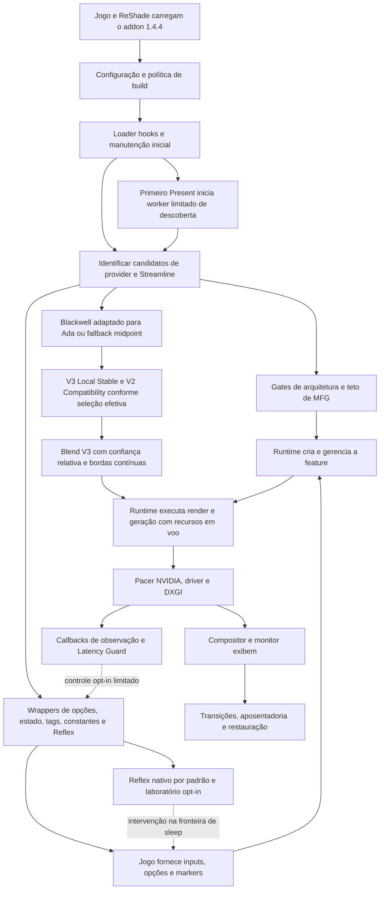

# Investigação de engenharia do DLSS-G em Ada

Data: 17 de outubro de 2026. **Base principal revisada: release 1.4.4, a mesma dos benchmarks.** Entrega: diagnóstico, evidências e propostas; nenhuma correção do mod foi implementada. HUD/UI permanece fora do backlog.

## 1. Conclusão executiva

**A release 1.4.4 é o objeto desta análise de código e dos resultados de Requiem. A branch aberta no IDE é apenas referência histórica.** A primeira versão deste relatório separava as bases, mas ainda usava a branch antiga para orientar parte do diagnóstico e das propostas. Isso era insuficiente: a separação não autorizava atribuir seus kernels, custos ou ausências à release. Esta revisão corrige a arquitetura, a validação e as prioridades pela fonte e pelas flags da 1.4.4.

1. **A proveniência da release foi conferida:** addon SHA-256 `5a193d86…747d5cd`, commit `3e898157fd59ed9eef65c181619060ddb305c6bd`; 76 arquivos de entrada e dois headers gerados coincidem com o manifesto, **78/78**. O addon registrado nas capturas tem esse mesmo hash. Não houve troca de branch nem substituição da árvore de trabalho.
2. **Várias “melhorias futuras” já existem na 1.4.4.** Ela contém geometria orientada Local Stable, confiança fotométrica relativa de luma/chroma, bordas contínuas por eixo e arbitragem ancorada no peso nativo. O trial de multiplicador já separa espera de aplicação e medição. Esses mecanismos precisam de avaliação causal; não devem ser propostos como funcionalidades ausentes.
3. **Alguns problemas de robustez continuam na release.** O matching Blackwell base ainda depende do footprint, sem identidade das instruções; o probe repetido com os headers da release aceita uma instrução alterada. O rollback excepcional de `thin_geometry.hpp` ainda pode liberar uma alocação se um descritor não foi restaurado. Gates amplos, aplicação parcial e omissões de erro na instalação/remoção de hooks também permanecem. São diagnósticos de código; não há crash em jogo atribuído a eles.
4. **Os benchmarks de pacing continuam favorecendo Legacy desmarcado no par disponível:** 189,52 contra 176,05 FPS exibidos, com menores p95/p99 exibidos. A diferença aproximada de 7,1% não é uma penalidade causal universal: houve uma passagem por caminho e mudança do modo de apresentação. Marcado espaça as submissões pela CPU; isso não comprova pixels melhores nem melhor cadência efetivamente exibida.
5. **A versão do provider ativo não está resolvida.** Os quatro logs dos traces mostram patches aplicados tanto ao candidato OTA 310.9.16 quanto ao local 310.9.1, com V3 Local e V2 Compatibility. Não se pode escolher 310.9.1 como provider executado só por existir uma DLL local. As capturas não vinculam um hash de provider à feature ativa. Streamline 2.8 está identificado; Dynamic com 2.14.16 continua uma validação separada.
6. **A suíte da fonte 1.4.4 compilou e passou em 32/32 testes.** Probes com as flags de política da release aceitaram os dois providers offline. Os dois blends completos V3 emitidos pelos headers da release passaram no JIT: 48 registros, 288 bytes shared e zero local reportado. Isso não mede duração, ocupação alcançada ou ganho de FPS. Os 18 testes e oito JITs da branch antiga ficam apenas como histórico.
7. **O próximo trabalho útil é medir o caminho crítico e validar os componentes já existentes.** Ainda não há evidência para retirar a espera do produtor, prometer o FPS de desmarcado com Legacy marcado, ativar histórico temporal ou emular o display engine de Blackwell por compute.

O ataque recomendado começa por semântica das medições e falhas de compatibilidade/rollback; depois, timeline produtor–GPU–apresentador e ablação da qualidade da própria 1.4.4. Nenhum percentual de ganho futuro é estimado.

## 2. Bases, proveniência e método

### 2.1 Baseline da investigação corrigida

| Base | Identificação | Papel nesta revisão |
|---|---|---|
| **S2 — release 1.4.4, principal** | Commit `3e898157fd59ed9eef65c181619060ddb305c6bd`; snapshot local `build/release-1.4.4/source/`; manifesto `out/release-1.4.4/renodx-mfgunlock.addon64.manifest.json` | Arquitetura, achados atuais, testes, payloads e propostas. O addon das capturas corresponde a este manifesto |
| **S1 — branch de trabalho, histórica** | `feature/dlssg-workload-opt-rd9`, HEAD `e1d55dbdc05ce9fc5f0133a3253d893016bc67e3`, com alterações locais | Entender a evolução e conservar resultados anteriores. Seus shaders/testes não são evidência de custo ou de ausência de recursos na 1.4.4 |
| **S3 — referências externas** | Documentação oficial e repositórios consultados em 17/10/2026 | Contratos e mecanismos transferíveis; não são medições deste mod |

Os identificadores S1/S2 foram preservados para não renomear os artefatos antigos. **S2 é a fonte padrão de toda referência de código a seguir.** `addon.cpp`, `framecount.hpp` e os demais headers, com suas linhas, referem-se ao snapshot da release; não às linhas da branch aberta. A [referência pública fixada no mesmo commit](https://github.com/mavismmg/MFGAdaUnlock-RenoDx/tree/3e898157fd59ed9eef65c181619060ddb305c6bd) permite revisão sem depender de `main` móvel. Nenhum merge ou checkout foi feito.

O manifesto registra `source_modified=false`. Foram novamente conferidos os 76 inputs e agora também os **dois headers gerados efetivamente usados pela release**. As flags específicas são `MFGUNLOCK_LOCAL_LOW_OVERHEAD`, `MFGUNLOCK_LOCAL_STABILITY`, `MFGUNLOCK_CONTINUOUS_BORDER_AXES`, `MFGUNLOCK_RELEASE_1_4_3` e `MFGUNLOCK_RELEASE_1_4_4`, além das definições Win32/Release/NOMINMAX. Os probes auxiliares desta revisão reproduzem essas flags de política e usam exclusivamente headers do snapshot S2.

`quality_build_policy.hpp:17–35` desativa histórico de confiança, fixa Local Stable e V2 Compatibility e impede combinar o build de baixo overhead com os modos de interceptação NVAPI indicados. O código-fonte contém pesquisa temporal, mas isso não a torna ativa no addon capturado. O header de variantes selecionado por `blackwell.hpp:42–45` neste build é **`thin_geometry_stability.generated.hpp`**, não o header de variantes da branch antiga.

### 2.2 Preservação e limites

A árvore original tinha 13 arquivos rastreados modificados e 13 não rastreados, antes do relatório. Foram preservados. O inventário/hash original de 81 arquivos continua arquivado; a revisão também conserva uma cópia do relatório anterior. A única entrega alterada na árvore de trabalho é este Markdown; logs, probes e resultados estão no diretório ignorado `out/ada-investigation-2026-10-17/release-1.4.4-revision/`.

Não foram alterados jogo, driver, DLL instalada, configurações, APIs, hooks ou kernels em uso. Não houve nova captura de gameplay. A compilação da suíte da release e os auxiliares produziram artefatos de build; não reconstruíram nem instalaram o alvo de produto `.addon64`. Os probes carregaram cópias dos providers em processos próprios com `DONT_RESOLVE_DLL_REFERENCES`, modificaram somente essas imagens e encerraram. O JIT carregou o programa, sem despachar o kernel.

A revisão principal cobre os mecanismos relevantes da 1.4.4, a seleção por flags, seus writers, sincronização, controles, testes e ferramentas. Isso não é um audit integral das dependências RenoDX/ReShade/Streamline, dos modos de pesquisa excluídos ou dos modelos privados NVIDIA.

### 2.3 Níveis de evidência

| Rótulo | Significado | Limite |
|---|---|---|
| **Código** | Fluxo diretamente identificado em S2 | Não prova frequência ou impacto em jogo |
| **Contrato** | API documentada pelo fornecedor | Não identifica sua implementação privada |
| **Offline** | Teste, parsing, patch/restore ou compilação fora do jogo | Não comprova dispatch, imagem, FPS ou latência física |
| **Captura** | Processo, configuração e versões registrados | Não generaliza para outro jogo/caminho; candidato mapeado não é feature ativa |
| **RE** | Disassembly corroborado por rastros | Restrito ao hash e caminho observado |
| **Hipótese** | Explicação ou benefício ainda não medido | Não é resultado |

“Confirmado” qualifica o diagnóstico especificado. A confiança no benefício de uma mudança é registrada separadamente.

## 3. Mapa de arquitetura da release 1.4.4



As setas representam integração e dependências, não a ordem completa dos kernels privados. “Aplicado ao candidato” não demonstra que aquele kernel foi despachado pela feature ativa.

### 3.1 Carregamento e descoberta

`addon.cpp:8294` (`DllMain`) registra o addon, lê configuração, instala loader hooks e executa manutenção inicial. `loadhook.hpp` observa `LoadLibraryW/ExW`, incluindo caminhos OTA; contextos de inicialização exigem cautela com loader lock. O callback tenta processar o módulo recebido; `TryAcquire` no bookkeeping evita bloqueio conhecido, mas não prova que toda operação em um callback de load seja segura.

`RunProviderMaintenance:1303`, os registros por `HMODULE` e a verificação de mapping deduplicam trabalho. `OnPresentStartDiscovery:2981` inicia o worker no primeiro Present real; **não executa uma varredura de módulos em todo Present**. `RunBoundedDiscoveryWorker:1943` faz até 40 passagens com 250 ms e termina após quatro passagens prontas e silenciosas. O worker mantém referência ao addon até sair. A release já trata o problema dos dispositivos temporários de descoberta do ReShade; a primeira versão deste relatório não descrevia essa evolução com precisão.

`IsDlssgProvider:686` reconhece candidatos por caminho ou exports/marcador. Um provider pode ser mapeado e receber patches sem ser selecionado. `DiscoveryRequirementsMet:1921` usa flags globais de prontidão; isso não é uma associação completa feature–provider–dispositivo. R04 permanece pertinente para essa fronteira, sem negar os mecanismos de geração que já existem em outros subsistemas.

### 3.2 Capacidade, opções e fronteiras de controle

`PatchArchGatesInModule:749` troca comparações de arquitetura `0x1b0` por `0x190`. Ele aceita 1–4 hits e registra sucesso se alguma escrita passar; a busca não valida identidade das instruções por perfil completo. `PatchFrameCountCeiling:1529` atua no limite do wrapper e no bypass do teto NGX. Capacidade anunciada, requisição aceita e multiplicador observado continuam distintos.

`framecount.hpp:2383` intercepta `slGetFeatureFunction` e fornece wrappers de `slDLSSGSetOptions`, `slDLSSGGetState`, `slReflexSetOptions` e **`slReflexSleep`**. Tags/constantes são observadas onde exportadas. `slInit` é interceptado somente para a seleção explícita de runtime; a instalação tardia não corrige uma inicialização que já aconteceu.

`force_policy.hpp`, `CallSetOptions:1268` e `HookedSetOptions:1897` preservam FG desligado, aplicam a política de override e fazem retries/fallback nas ABIs conhecidas. `runtime_version.hpp` distingue versões aceitas para Dynamic; D3D12, suporte reportado e exceção de Outlaws continuam necessários. A captura com Streamline 2.8 não valida Dynamic com 2.14.16, mesmo quando um candidato NGX 310.9.16 foi reconhecido.

Não foi identificada uma interceptação genérica ativa de CreateFeature/EvaluateFeature que dê ao mod propriedade de todas as filas internas. As funções antigas de bootstrap de vtable em `addon.cpp` não devem ser contadas como trabalho por frame sem callsite ativo. Os writers principais também não recebem uma autorização completa baseada em LUID/arquitetura do dispositivo efetivo. Query de adapter para telemetria não substitui esse gate.

### 3.3 Programas GPU e política efetiva

| Caminho em S2 | Intervenção | Identidade / recursos / fallback |
|---|---|---|
| Blackwell base adaptado | Substitui programas auxiliares compilados para `sm_89`, nos papéis MV/inpaint/decisão | `blackwell.hpp:313` usa text/shared/registros/slot, sem hash das instruções; indisponibilidade tenta midpoint |
| V3 Local Stable geometry | Seleciona o scatter local orientado já construído | A variante verifica hash do payload original; pode exceder o slot e usar `RedirectOversizedCubin:454`; não é um passe cumulativo |
| V2 Compatibility inpaint | Seleção de decisão compatível fixada pela política de build | Não ativa V3 temporal só porque esse payload está no header; fallback preserva componente validado |
| Blend V3 | Reescreve PTX com confiança relativa, bordas contínuas por eixo e arbitragem ancorada | Metadata/perfil, PTX normalizado, ABI/âncoras e localização única; `thin_geometry.hpp:247` e `RedirectFatbin`; preserva entradas restantes do fatbin |
| Midpoint | Corrige uso da fase temporal no caminho identificado | Fallback independente e perfil próprio; não substitui um framework completo já aplicado |

O scatter V3 Local tem **43.168 bytes**, acima do slot original de 39.968; logo, o mapa antigo que falava apenas em replacements que cabem nos slots não descreve toda a release. O writer reconstrói o fatbin e redireciona descritores. Sua alocação deve sobreviver a todo consumidor. A restauração normal de Blackwell retém memória se um restore falhar; o ramo excepcional inseguro R03 pertence ao redirecionamento PTX em `thin_geometry.hpp`, não deve ser atribuído indiscriminadamente a todo redirect.

Não se executa SASS Blackwell diretamente em Ada, e a reconstrução de kernels auxiliares não fornece display engine, Tensor Cores ou scheduler de outra arquitetura. O papel aplicado não garante que cada programa execute em todo frame.

### 3.4 Inputs, memória e sincronização

O jogo produz cor, depth, movimento, câmera e lifecycles; o runtime possui os buffers e filas internos de FG. `input_diagnostics.hpp` observa até oito viewports e 64 tags por chamada, sem ler pixels. Token verdadeiro de `slSetTagForFrame`, endereço de recurso e Present próximo têm significados diferentes; endereço estável não identifica geração de alocação. O fluxo de compatibilidade existente foi examinado apenas para entender propriedade e transições, sem proposta de HUD/UI.

`memory_policy.hpp` classifica estimativas; não é allocator nem ferramenta de limpeza. A estimativa de VRAM é pedida explicitamente e consumida no caminho de estado; telemetria DXGI depende do painel e é limitada. Não foi demonstrado leak na release. Cópias, conversões, retenção e churn internos exigem timeline própria antes de qualquer alteração de lifetime.

O [header oficial DLSS-G 2.14.16](https://github.com/NVIDIA-RTX/Streamline/blob/v2.14.16/include/sl_dlss_g.h) diz que `eBlockNoClientQueues` é suportado em Vulkan e recai no bloqueante em D3D; os fences de consumo ainda precisam ser respeitados. `GetState`/`SetOptions` não são thread-safe segundo esse contrato. Essas APIs não autorizam um botão genérico de async compute em Requiem.

### 3.5 Pacing, Reflex e observação

**Legacy desmarcado preserva a decisão do runtime NVIDIA; marcado força o fallback de software do plugin.** No plugin 2.8 capturado, a evidência distingue metering mediado pelo driver de Presents espaçados pela CPU. Ambos são caminhos NVIDIA; o interior do primeiro não foi identificado como hardware Blackwell.

A release já contém `reflex_pacing.hpp`. `framecount.hpp:998` tem despacho nativo direto no steady state, medição condicionada, bypass opt-in de sleep e laboratório DXGI waitable. `UpdateReflexPacingLab:2222` tem saída antecipada quando o laboratório/medição/cap estão inativos. Não há justificativa para propor sua criação nem atribuir todo o seu trabalho ao caminho nativo de cada frame.

O laboratório possui handle duplicado, geração, readers, aposentadoria e checagem de tokens/concorrência; `RetireWaitable:251` evita fechar o handle ainda lido. **Duplicar o handle não concede ownership exclusivo do sinal do proxy.** Validar coexistência com o pacer continua obrigatório. O [guia DLSS-G 2.14.16](https://raw.githubusercontent.com/NVIDIA-RTX/Streamline/v2.14.16/docs/ProgrammingGuideDLSS_G.md) descreve a exclusividade de consumo do waitable e distingue Present de mudança exibida; esse contrato não identifica automaticamente o caminho privado do plugin 2.8.

O nome histórico `g_reflex_source_fps_cap` também pode confundir: a 1.4.4 encaminha o controle explícito como **alvo final/output** (`ResolveExplicitReflexTarget:629`). Já o QueueTrial calcula cap de **fonte** e o converte ao alvo de saída antes de encaminhar ao Reflex (`pacing_policy.hpp`). A alegação antiga de que todo cap exposto era de fonte estava incorreta para esta release. Aceitação de opções não comprova que o native sleep esteja executando; a fonte já distingue esse estado.

`UpdateLatencyGuard:2595` usa amostras, epoch, confiança separada e thread proprietária. `RefreshReflexTarget:952` pode adiar submissão. `MultiplierTrial` já tem baseline, espera pelo multiplicador vivo, janela de candidato e tentativa de retorno ao original. A lacuna L01 foi reduzida ao **QueueTrial**, cujo relógio ainda começa na proposta, antes de confirmação específica de aplicação. Melhorar um proxy pode reduzir frames reais ou aumentar input age; latência física segue sem medida.

### 3.6 Transições e encerramento

Callbacks acompanham swapchain, API, device, HDR e mudanças de opções. O primário usa heurística de área; isso não prova qual viewport tem FG ativo. A política `stability_policy.hpp` e resets já existem na release, assim como a geração do waitable: R04 não propõe recriar esses mecanismos.

No encerramento do processo a fonte evita restauração de imagens já recolhidas pelo Windows. No unload explícito remove callbacks, aposenta o laboratório e tenta remover hooks/restaurar patches. Detach de Detours é best-effort; faltam garantia abrangente de quiescência e identidade de geração de provider antes de todas as restaurações. Retornar de `DllMain` não impede o unload. Uma fronteira segura deve existir antes dela, sem transformar um wait em `DllMain` em protocolo de teardown.

### 3.7 Propriedade, duração e fallback por etapa

| Etapa | Proprietário e intervenção disponível | Sincronização / duração | Fallback e limite |
|---|---|---|---|
| Load e descoberta | Host/OS carregam; mod instala gatilhos e classifica candidatos | Loader context, travas de manutenção e referência própria do worker; sessão do módulo | Retry limitado/load hook tardio; não garante interceptar todo primeiro uso |
| Capacidade e teto | Mod escreve gates/wrapper; runtime ainda decide feature e suporte | Antes do uso seria a fronteira desejada; segurança de instalação concorrente não provada | Perfil recusado não recebe patch; sucesso parcial atual é R02 |
| Payloads e descritores | Mod possui replacement/alocação; runtime consome o fatbin | Alocação deve viver até cessar todo consumidor; registro CUDA pode durar além do patch inicial | Midpoint/perfil próprio ou componente validado; reter memória quando restore falhar |
| Opções e criação | Jogo/runtime criam feature; mod adapta chamadas expostas | ABI, owner de replay e thread-safety das APIs; opção aceita vale na sessão correspondente | Requisição nativa/retry; mod não reordena genericamente a feature |
| Inputs e render | Motor possui recursos/câmera; mod observa metadados | Tags/lifecycle e fences de consumo; endereço não é geração | Inputs originais; sem extensão de lifetime presumida |
| Geração | Runtime/driver possuem filas, modelos, buffers e dispatch | Dependências privadas, GPU execution e consumidores em voo | Política nativa e replacements aceitos; mod não possui ring interno |
| Reflex/controle | Jogo fornece markers/sleep; mod intercepta fronteira e opções | Owner thread, epoch, tokens, trava de replay; readers/geração protegem handle do laboratório | Native sleep por padrão; lab tem fallback, mas exclusividade do sinal ainda precisa de prova |
| Apresentação | Plugin/pacer, driver e DXGI; mod seleciona Legacy e observa | Deadlines/fences do plugin; recursos permanecem vivos até consumo real | Decisão NVIDIA nativa ou fallback forçado; sem autorização para remover waits |
| Exibição | OS/compositor/display engine/monitor | Fila, composição e scanout; Present CPU não é evento de pixel | Mod não comanda scanout; medir display e input-to-photon separadamente |
| Teardown | Host inicia unload; mod restaura o que possui | Calls/readers e módulos precisam permanecer vivos; quiescência global não demonstrada | Reinício/preservação de memória quando não houver restauração segura; R03–R05 |

## 4. Evidências de pacing reexaminadas

### 4.1 Conjunto e comparabilidade

Configuração registrada: RTX 4070 SUPER, driver 617.42, Requiem (`re9.exe`), 4x nativo, Streamline 2.8.0.0. A atribuição anterior a DLSS-G 310.9.1 era incompleta. Os quatro `ReShade-session.log` dos traces registram o candidato OTA 310.9.16 e o local 310.9.1, ambos com V3 Local Stable, V2 Compatibility, blend relativo e bordas V3 aplicados. Isso prova instalação nesses candidatos, não seleção/dispatch. Os benchmarks de 30 s não têm esse log de sessão no diretório; não lhes foi atribuída retroativamente uma rota ativa por inferência. **Os inventários JSON das capturas não incluem um hash do provider NGX**; incluem o plugin Streamline e o addon. O hash do provider usado nos probes offline não preenche automaticamente essa lacuna da captura.

| Evidência local | Duração e finalidade | Limite decisivo |
|---|---|---|
| `benchmarks/20261017-115427-requiem-runtime-4x-r1/` | 30 s; PresentMon, Legacy 0 | Uma passagem; modo dominante próprio |
| `benchmarks/20261017-115926-requiem-software-4x-r1/` | 30 s; PresentMon, Legacy 1 | Uma passagem; modo de apresentação mudou |
| `benchmarks/20261017-121951-requiem-runtime-4x-trace1-bdd83efb/` | 15 s; scheduling/CPU | Perfil inicial sem DxgKrnl; não é benchmark GPU |
| `benchmarks/20261017-122313-requiem-software-4x-trace1-7700181f/` | 15 s; scheduling/CPU | Mesma limitação gráfica |
| `benchmarks/20261017-123507-requiem-runtime-4x-graphics1-2634db1b/` | 5 s; perfil corrigido; foreground | Não há timeline de execução GPU do jogo utilizável |
| `benchmarks/20261017-124116-requiem-software-4x-graphics1-f8a2d71f/` | 5 s; perfil corrigido; foreground | Mesma limitação; submissão não é scanout |

O smoke intermediário `20261017-122814-requiem-software-provider-validation-79ce30e4` confirmou presença de eventos gráficos após corrigir os buffers nonpaged. Não é uma terceira passagem comparável. Os registros anteriores não reportaram perda de eventos; presença de QueuePacket e ausência de perda não garantem cobertura da execução necessária.

### 4.2 Resultado exibido preliminar

Valores dos `presentmon.summary.json`, sobre as linhas do swapchain e modo dominante selecionados:

| Métrica | Legacy desmarcado | Legacy marcado |
|---|---:|---:|
| FPS exibido médio | 189,52 | 176,05 |
| Intervalo exibido mediano | 5,2387 ms | 5,7563 ms |
| p95 exibido | 5,8657 ms | 7,3767 ms |
| p99 exibido | 6,6769 ms | 7,9088 ms |
| Modo dominante | Hardware: Independent Flip | Hardware Composed: Independent Flip |
| Razão heurística de cadência | 3,996x | 3,998x |

A diferença relativa de FPS é aproximadamente −7,1% para marcado **neste par**. Ela mistura efeito da configuração, modo de apresentação e variação de duas passagens manuais. Não estabelece uma penalidade universal do Legacy nem sua causa. Não usar contagens de outliers calculadas com thresholds diferentes para afirmar quantos stutters extras houve.

A divisão de `AnimationTime` é heurística, corroborada por requisição aceita/telemetria, não rótulo autoritativo de frame. O campo `application_intervals` muda de domínio aparente: média de 19,3652 ms desmarcado versus 5,8404 ms marcado. Os campos de GPU e latência também não sustentam comparação direta entre esses caminhos. Em particular, **não se conclui redução de latência de aproximadamente 29 para 7 ms** desses summaries.

`Analyze-PresentMon.ps1:109` de S2 escolhe entre colunas alternativas e agrega famílias de métricas. É útil para inspeção dentro de um domínio consistente; falta uma identidade semântica explícita que bloqueie comparação de definições diferentes. O backlog M01 trata isso. As [limitações documentadas pelo PresentMon](https://github.com/GameTechDev/PresentMon/blob/main/README.md#tracking-gpu-work-with-hardware-accelerated-gpu-scheduling-enabled) também restringem inferências sobre execução da GPU com HAGS.

### 4.3 Recontagem dos eventos brutos

Nesta investigação, os CSVs brutos gráficos foram percorridos novamente, filtrando os eventos DXGI do processo do jogo. Pares Start/Stop foram associados por thread. A recontagem reproduziu os JSONs anteriores:

| Métrica de CPU, não de exibição | Legacy 0 | Legacy 1 |
|---|---:|---:|
| Present Start / chamadas concluídas | 1.008 / 1.008 | 934 / 934 |
| Tempo mediano dentro da API | 280 µs | 329 µs |
| Intervalo mediano entre submissões | 1.070 µs | 5.694 µs |
| Intervalos menores que 1.500 µs | 747 de 1.007 | 1 de 933 |
| Intervalos maiores que 10.000 µs | 251 de 1.007 | 1 de 933 |

Desmarcado apresenta grupos de submissões curtas seguidos de pausa; exemplo: `958, 982, 631, 18533 µs`. Marcado espaça chamadas em torno de 5,6–5,9 ms. Isso **não demonstra que desmarcado mostra três frames juntos no monitor**. A regularização da CPU é compatível com a experiência relatada, mas não mede qualidade dos pixels ou sensação de fluidez.

### 4.4 CPU, waits e código do plugin

Os pesos exclusivos de CPU de `sl.dlss_g.dll` nos `cpu-profile.csv` foram somados novamente: **37.875 µs** no runtime e **1.221.562 µs** no software. São CPU amostrada acumulada em rastros de 15 s; não tempo serial acrescentado a cada frame.

No slice exploratório de 5–6 s, salvo nos `wait-summary-5-6s.json`:

| Observação | Runtime | Software |
|---|---:|---:|
| Espera do worker `+0x2c8ed` | 45; mediana 16,668 ms | 42; mediana 7,635 ms |
| Espera adicional via `+0x1c407`/`+0x208bb` | Não observada nesse slice | 42; mediana 14,659 ms |
| Sleep do apresentador `+0x29681` | Não observado nesse slice | 263; mediana 1,820 ms |
| Espera de recurso `+0x1e164` | Não observada nesse slice | 83; mediana 3,760 ms |

Os atrasos medianos ready-to-running ficaram aproximadamente em 11–15 µs, insuficientes para sustentar uma solução de milissegundos por prioridade de thread. O parser agrupa waits concluídos pela pilha de retomada e ReadyThread, não por uma suposta pilha de saída da CPU. Trata-se de um slice, não da distribuição completa de todas as cenas.

O disassembly salvo em `out/flip-metering-2026-10-17/sl-2.8-disasm.txt` foi reexaminado. Para o plugin de hash `D7FA7559…CF09DA`:

- RVA `0x1fc80` monta configuração V1 `0x10018` e chama o ponteiro NVAPI resolvido na inicialização como `SetFlipConfig`.
- A pilha observada em desmarcado contém o retorno `0x1dbf0` após a chamada direta ao apresentador comum `0x28ae0`; isso vai além de apenas haver uma API disponível.
- A região `0x29530`–`0x29681` calcula deadline com QPC, consulta condicionalmente fence e usa Sleep(1) quando o restante atinge 2.000 µs; abaixo disso volta a consultar tempo.
- O caminho habilitado de metering evita esse loop de espaçamento pela CPU; o fallback forçado o usa.

A interpretação sustentada é **metering mediado pelo driver versus Presents espaçados pela CPU**, para esse plugin e os caminhos capturados. RSYNC nomeia o fallback de software do plugin; não é VSync nem o mecanismo dedicado de Blackwell. Desmarcar preserva a escolha do runtime, que pode recair em fallback em outra versão ou falha.

As filas do jogo aparecem nos eventos de submissão/rundown, mas os DmaPackets de execução observados cobrem um contexto separado de sistema. Não há prova de GPU ociosa por causa da espera do produtor. A falha anterior do helper de Nsight (`content hash mismatch: SKILL.md`) está documentada no estudo Legacy; esta investigação não alterou a instalação nem realizou captura Nsight.

## 5. Verificação da base 1.4.4 e matriz de evidências

### 5.1 Testes e probes executados nesta revisão

| Verificação | Resultado | Limite |
|---|---|---|
| Manifesto S2 versus snapshot e headers usados | **78/78 hashes coincidem**, 76 inputs + dois gerados | Liga fonte e artefato pelo manifesto; não é uma reconstrução binária determinística |
| `cmake --build build/release-1.4.4/vs --config Release` | Sucesso, MSVC 19.44 / VS 2022 | Compila a suíte e o alvo de compilação; não reconstrói o `.addon64` de produto excluído do all |
| `ctest --test-dir build/release-1.4.4/vs -C Release --output-on-failure` | **32/32 passaram**, 7,22 s reportados pelo CTest | Contratos/sintéticos; não mede gameplay, GPU ou latência física |
| Mutação de instrução + `FingerprintElf`/`MatchReplacement` de S2 | `original_match=1 mutated_instruction_match=1 same_entry=1` | Confirma identificação insuficiente do base; não reproduz corrupção em jogo |
| `provider_release_probe --adaptive`, headers e flags de política S2 | **2/2 exit zero**, 310.9.1 e 310.9.16; geometry V3 Local, inpaint V2 Compatibility e blend V3 reconhecidos | Não cria feature nem faz dispatch; inclui mecanismos adicionais do harness, não reproduz sozinho a configuração do usuário |
| Emissão C++ do blend completo, macros S2, depois JIT para `sm_89` | **2/2 compilaram e carregaram**, sem dispatch | Não comprova que o JIT do jogo produza os mesmos recursos nem que a imagem melhore |
| Quatro logs salvos dos traces | Mesmos componentes V3 aplicados aos dois candidatos .1/.16 | Não são quatro benchmarks de qualidade nem prova do provider ativo |

A suíte de S2 cobre políticas de release/pesquisa, isolamento, estabilidade/bordas, runtime, Reflex, memória, versões, diagnóstico e qualidade. Os alvos usam flags distintas deliberadamente; **32/32 não significa 32 testes de gameplay com a DLL distribuída nem que todo alvo foi compilado com todas as flags de produto**. O probe auxiliar específico usa as cinco flags de política da release para evitar o default de pesquisa do `provider_probe` genérico.

Os resultados de S1 — 18/18 CTests, seis probes e oito JITs de combinações antigas — foram preservados, mas retirados da validação principal. Não caracterizam o shader V3 da 1.4.4. As falhas iniciais de compilação do harness auxiliar desta revisão foram de configuração do próprio harness (include ReShade e assinatura C++ diferente); foram ajustadas somente em `out/`, sem corrigir fonte da release. A suíte existente não apresentou falha.

### 5.2 Recursos dos payloads da release

Leitura dos headers cujo hash consta no manifesto, e não dos gerados de S1:

| Programa em S2 | Cubin / text bytes | Shared bytes | Registros | Situação |
|---|---:|---:|---:|---|
| MV Blackwell base, slot 39.968 | 37.920 / 34.560 | 7.776 | 40 | Base/fallback para esse slot |
| Inpaint Blackwell base | 13.984 / 10.368 | 3.920 | 35 | Papel auxiliar, distinto da decisão |
| Decisão Blackwell base | 12.704 / 9.216 | 784 | 48 | Base |
| Geometry V3.1 Local Stable | 43.168 / 39.680 | 7.776 | 40 | Seleção V3 Local; exige redirect por exceder o slot |
| Inpaint decision V2 Compatibility | 12.704 / 9.216 | 784 | 48 | Seleção de compatibilidade da release |

O header também contém variantes de pesquisa, inclusive temporais; presença no arquivo não significa seleção pelo build. O manifesto registra mecanismos e identidades dos inputs. Não se reconstruíram os payloads de fornecedor para sobrescrever o header. Reduzir tamanho ou instruções não prova reduzir tempo, e aumentar registros não prova regressão de ocupação sem shape efetivo.

### 5.3 Blend V3 completo emitido com a política da release

O emissor chama `RewriteValidatedWarpBlend` de S2 com perfil `kLuminanceDirectionalV3`, Adaptive ligado, fotometria/borda direcionais e as flags Local Stable/continuous axes. A origem PTX normalizada é identificada por hash; o target foi adaptado para Ada. O driver 617.42 carregou a função, mas não a executou.

| Provider offline | Registros da função carregada | Shared / local bytes | Máximo de threads reportado |
|---|---:|---:|---:|
| 310.9.1 | 48 | 288 / 0 | 256 |
| 310.9.16 | 48 | 288 / 0 | 256 |

A fonte já insere `.maxnreg 48` no caminho V3 Local relevante. Não se recomenda impor um teto como otimização inédita. O atributo máximo de threads não fornece o launch shape executado pelo jogo; zero local reportado não mede stalls. O [guia de tuning de Ada](https://docs.nvidia.com/cuda/ada-tuning-guide/index.html) explica por que configuração e recursos condicionam ocupação. Duração dos kernels, ocupação alcançada, bandwidth/cache, divergência e contenção de atomics continuam sem medição.

### 5.4 Matriz de conclusões e sustentação

| Conclusão / item | Evidência principal | Versão / limitação |
|---|---|---|
| Release dos benchmarks identificada; B01 | Manifesto, addon SHA-256 dos inventários, 78 hashes | S2; provider ativo ainda não ligado à feature |
| Matching base fraco; R01 | `blackwell.hpp:313–324`, probe de mutação S2 | Footprint aceito com instrução alterada; sem incidente em jogo |
| Gates/Legacy não transacionais; R02 | `addon.cpp:749–824`, `1684–1850` | Código S2; não demonstra corrida ou corrupção em captura |
| Rollback excepcional inseguro; R03 | `thin_geometry.hpp:805–819`, contraste com `Restore:868` | Código S2; depende de contagem >32 e falha de restore |
| Identidade de provider e teardown incompletos; R04/R05 | Registros `HMODULE`, flags globais, restore, `ngx_hook.hpp:41–60`, `Uninstall` | Mecanismos de geração do waitable já existem; não extrapolar sua ausência |
| Trial de multiplicador já tem fases; QueueTrial não tem ack; L01 | `latency_trial.hpp:12–74`, `240–488`; `addon.cpp:2954–2974` | S2; confirmação de valor vivo não comprova pixels ou input-to-photon |
| Semântica de métricas não uniforme; M01 | `Analyze-PresentMon.ps1:109–121`, summaries e CSVs de Requiem | Mesmas unidades não tornam campos equivalentes |
| Legacy CPU espaçado e mais custo; L02/L03 | CSVs, stacks e disassembly exato do plugin | Streamline 2.8 hash `d7fa…09da`; execução GPU útil ausente |
| V3 relativo/border/arbitragem existentes; Q01/Q02 | `adaptive_quality_v3.hpp:18`, `81`, `335`, `446`; `thin_geometry.hpp:390–517`; logs | Instalação observada; não há comparação cega por componente |
| Geometry Local Stable e V2 existentes; Q01/Q03 | Flags, `quality_build_policy.hpp`, header gerado e probes | Seleção local, sem histórico persistente |
| Pacing lab existente; X02/P02 | `framecount.hpp:998`, `reflex_pacing.hpp:232–290`, `addon.cpp:2222` | Ownership de sinal externo ainda precisa ser provado |
| Ganhos GPU/qualidade/latência não demonstrados; P01/P03/Q03/X01 | Ausência dos joins, pixels e medição física descritos na seção 11 | Hipóteses condicionais, não resultados negativos universais |

## 6. Qualidade existente na release e interações

| Mecanismo | Implementação e acesso em S2 | Risco residual / validação |
|---|---|---|
| Midpoint e base Blackwell adaptada | Corrigem tempo/selecionam programas auxiliares em perfis conhecidos | Não corrigem vetores ou depth inválidos nem garantem custo equivalente |
| Retention, Balanced/Aggressive e V2 | Alternativas existentes para o scatter; suporte local de movimento/depth | Não são filtros cumulativos; retenção extra pode preservar candidato errado |
| V3 Local Stable orientado | Variante gerada de scatter local, com suporte orientado, sem histórico persistente | Benefício por silhueta/fase deve ser isolado; coerência local pode estar errada |
| Validated Warp e confiança V3 | Bounds, sentinels e finitude continuam estruturais; semântica contínua usa evidência do frame atual e âncora nativa | Já substitui gates semânticos anteriores no perfil V3; não descrevê-lo como o gate duro antigo de S1 |
| Fotometria V3 relativa | Diferenças de luma/chroma normalizadas por escala local, reutilizando cores disponíveis; sem novo recurso de textura nesse fragmento | Não prova linearidade da cor, invariância total à exposição nem classificação correta de sombra; Q02 passa a validar a solução existente |
| Borda V3 contínua por eixos | `ContinuousAxisBorderProgram`, selecionado por macro da release | Não propor “adicionar border” ou portar eixos contínuos; validar cantos, movimento reverso e detalhe |
| Arbitragem V3 ancorada | Atenua o incremento do candidato mais fraco em direção ao seu peso nativo | Confiança não garante o warp correto; comparar com o caminho sem incremento |
| V2 Compatibility inpaint | Política da release usa o componente de compatibilidade, com tratamento de não finitos e fallback | Não confundir com inpaint V3 temporal nem prometer reconstrução de cor ausente |
| Histórico temporal | Backend/fases/arenas existem no código de pesquisa | Desativado no binário 1.4.4; sua ausência de custo é relevante ao benchmark |

Scatter e blend continuam sendo estágios diferentes. Não há um canal comum de confiança demonstrado que autorize transportar seus registradores/penalidades sem mapping de coordenadas e lifetime. A cobertura direcional nativa e o suporte local já devem ser considerados antes de adicionar taps; novos acessos/atomics podem custar mais ou reforçar erro.

V3 reutiliza valores locais e não adiciona histórico por causa do nome “Stable”. Seleção efetiva pode sofrer fallback; controles e componentes aplicados devem acompanhar cada avaliação. Os quatro logs registram os componentes V3 instalados em ambos os candidatos, mas não constituem ablação nem identificação por dispatch. A qualidade já aprovada informalmente em outros jogos não substitui uma comparação em movimento e por fase da release.

## 7. Revalidação dos estudos e das propostas da primeira versão

Estados abaixo referem-se à **1.4.4**, não à branch S1.

| Achado ou proposta anterior | Estado em S2 | Consequência |
|---|---|---|
| B01: descobrir qual código gerou o addon | **Resolvido para este relatório** | 78 hashes + manifesto + addon capturado; manter a disciplina nos próximos experimentos, sem criar ferramenta duplicada |
| L1/L2: unidade/freshness/epoch de timestamps e zero válido | **Parcialmente resolvido / resolvido nos contratos testados** | Há código e testes; latência física e identidade do input exibido seguem ausentes |
| Trial de multiplicador sem fases de aplicação/medição | **Obsoleto como descrição atual** | `MultiplierTrial` já espera o valor vivo e tem janelas/retorno; L01 fica restrito ao QueueTrial e à validação residual |
| QueueTrial começa antes do ack | **Aberto** | `started=now` na proposta e refresh pode ficar pendente; sem evidência de que causou a diferença de Legacy |
| Ownership/replay e refresh repetido de Reflex | **Amplamente resolvido nos contratos testados** | Owner thread, reentrada, chain não retida e deduplicação já existem; manter auditoria de unload |
| Polling contínuo de providers em Present | **Resolvido** | Worker limitado iniciado no primeiro Present; não propor sua remoção de novo |
| Confiança fotométrica absoluta sem normalização | **Obsoleto para V3 relativo selecionado** | Luma/chroma relativa já existe; Q02 valida domínio/erros residuais |
| Border ausente ou precisa de eixos contínuos | **Obsoleto para a release** | Flags e emissão S2 selecionam continuous axes |
| Geometria apenas V1/V2 | **Obsoleto para V3 Local** | Local Stable orientado e redirect oversized já existem |
| Histórico temporal inexistente no projeto | **Obsoleto** | Backend existe em pesquisa; permanece desativado na 1.4.4 por política |
| Todos os writers exigem conteúdo exato | **Refutado em S2** | Matching base e gates continuam mais amplos; R01/R02 permanecem |
| Ramo excepcional libera fatbin ainda referenciado | **Aberto em S2** | R03 revalidado no writer de PTX; restore normal já é conservador |
| Laboratório Reflex/waitable ausente | **Obsoleto** | Já existe e tem gestão de readers/geração; X02 começa pela auditoria desse código |
| “Cap explícito = cap de fonte” | **Incorreto para S2** | Controle explícito é output; QueueTrial privado raciocina em fonte e converte |
| Captura prova provider 310.9.1 ativo | **Não demonstrado** | Logs mostram .1 e .16 instalados; não resolvem seleção |
| 310.9.16 validado com Streamline 2.14.16 em jogo | **Parcialmente resolvido offline; aberto em jogo** | Probes/perfis passam; os traces são com plugin 2.8 |
| Pixels, GPU e latência correlacionados | **Aberto** | Sem esses dados não há causalidade de ganho visual nem solução de throughput |
| Novas propostas HUD/UI | **Fora do escopo** | Manter automatic guard + UI existentes; sem reabertura desse trabalho |

## 8. Catálogo revisado de melhorias e experimentos

As propostas usam S2. Nenhuma foi implementada nesta investigação. A presença de um mecanismo implementado não comprova seu benefício visual; sua avaliação aparece separada de sua criação. Diagnóstico e benefício têm níveis de confiança distintos.

### B01 — Manter fonte, flags, payloads e captura na mesma base

- **Categoria / estado:** Compatibilidade e medição; **concluído para a correção deste relatório**, requisito para próximos experimentos.
- **Atual / evidência / problema:** Manifesto da 1.4.4 já existia e liga 78 inputs ao addon capturado. A primeira versão ainda misturava recomendações de S1; ferramenta ausente não era a causa.
- **Mudança proposta:** Usar a base S2 explicitamente em análise, testes e emissão; registrar captura → addon → manifesto → configuração efetiva → provider/feature. Reutilizar `write_build_manifest.py`, `quality_build_policy.hpp` e `validation_status.hpp`, sem novo formato duplicado.
- **Benefício condicionado / riscos:** Evita atribuição falsa e trabalho repetido; não produz FPS. Um manifesto sem flags efetivas ou sem identidade do provider ainda permite ambiguidade.
- **Complexidade / confiança:** Baixa para processo; Média se reconciliar branches no futuro. Diagnóstico e utilidade de rastreabilidade **Confirmados**.
- **Validação / fallback:** Hashes e seleção resolvidos por experimento; divergência bloqueia a comparação. Preservar bases e rotular os dados incompletos como contexto.

### M01 — Identificar a semântica de cada métrica antes de comparar

- **Categoria:** Latência, fluidez e medição.
- **Atual / evidência / problema:** `Analyze-PresentMon.ps1:109–121` de S2 ainda escolhe colunas alternativas para famílias agregadas. Requiem mostra domínio aparente diferente de aplicação/latência entre caminhos; mesma unidade não é mesma medida.
- **Mudança proposta:** Exportar coluna original, coletor/versão, evento inicial/final, população e classificação. Impedir comparação automática de latência/GPU/fonte quando essas identidades diferirem; preservar schemas antigos sem fallback silencioso entre definições.
- **Benefício condicionado / riscos:** Conclusões confiáveis, sem ganho direto de FPS; relatórios poderão declarar indisponível em vez de mostrar número enganoso.
- **Complexidade / confiança:** Baixa–Média. Diagnóstico e benefício de medição **Confirmados**.
- **Validação / fallback:** Fixtures de `MsPCLatency`, `InstrumentedLatency`, `DisplayLatency` e schemas diferentes não podem ser fundidas sem equivalência demonstrada. Exibir estatística por coluna e sinalizar mudança de PresentMode quando não houver equivalência.

### R01 — Exigir identidade do conteúdo no Blackwell base

- **Categoria:** Compatibilidade e estabilidade.
- **Atual / evidência / problema:** `blackwell.hpp:313–324` de S2 aceita text/shared/registros/slot. O probe S2 com instrução alterada continua selecionando a mesma entrada. A variante com hash não protege o base quando ela é indisponível e ocorre fallback.
- **Mudança proposta:** Gerar identidade do payload original, ABI e entrypoint por replacement base; verificar antes da escrita. Manifestar replacement e gerador. Hash de compatibilidade não deve ser apresentado como autenticação criptográfica.
- **Benefício condicionado / riscos:** Recusa de provider com mesmo footprint e conteúdo incompatível, sem FPS adicional previsto. Suporte mais conservador até validar novos perfis; custo de hash é de inicialização.
- **Complexidade / confiança:** Média. Diagnóstico **Confirmado por probe S2**; prevenção de incidente concreto **Forte hipótese**, sem incidente reproduzido.
- **Validação / fallback:** Mutar instrução, parâmetros, símbolo e tamanho, aceitando os originais e recusando incompatíveis; conferir restore byte a byte. Usar midpoint somente se seu próprio perfil for aceito; caso contrário não promover suporte não validado.

### R02 — Tornar gates e patches Legacy específicos e transacionais

- **Categoria:** Compatibilidade, estabilidade e fluidez.
- **Atual / evidência / problema:** `addon.cpp:749–824` aceita 1–4 comparações genéricas e sucesso parcial. `TryPatchFlipMeteringInModule:1684` deriva deslocamento por marcador e busca stores, podendo reescrever sete bytes. Correspondência de bytes não prova fronteira de instrução, objeto ou papel semântico.
- **Mudança proposta:** Descoberta sem escrita, preflight de todos os sites, perfis de conteúdo/contexto e commit/rollback por módulo. Vincular prontidão à sessão e ao dispositivo/arquitetura efetivos numa fronteira em que essa informação exista. Aplicar antes do primeiro uso demonstrado ou sob quiescência comprovada; polling tardio não autoriza patch ativo.
- **Benefício condicionado / riscos:** Menos aplicação parcial e incompatibilidade silenciosa; nenhum ganho de FPS demonstrado. Perfis restritos podem recusar atualização; a instalação precoce é difícil em alguns jogos.
- **Complexidade / confiança:** Alta. Aplicação parcial **Confirmada**; corrida/corrupção concreta **Forte hipótese**, não reproduzida.
- **Validação / fallback:** Falhar cada `VirtualProtect`, simular padrão dentro de outra instrução e testar arquitetura não alvo, multiadapter e providers conhecidos/desconhecidos. Todos os sites esperados ou nenhum; sem fronteira/perfil seguro preservar nativo e informar recusa.

### R03 — Não liberar fatbin quando o rollback ficar incompleto

- **Categoria:** Estabilidade.
- **Atual / evidência / problema:** `thin_geometry.hpp:805–819` de S2 restaura os redirects quando há >32 referências, mas limpa o registro e libera a alocação mesmo se uma restauração falhar. `Restore:868` já retém memória nesse tipo de falha. Um descritor pendente poderia apontar para memória liberada; não houve crash observado.
- **Mudança proposta:** Validar contagem antes de escrever e unificar a regra de lifetime do rollback com restore normal; manter alocação e registro pendente enquanto houver referência. Não confundir esse ramo com o redirect oversized de Blackwell, que usa outro protocolo.
- **Benefício condicionado / riscos:** Evitar dangling pointer em falha excepcional; sem alteração esperada de throughput ou imagem. Uma falha poderá reter memória até terminar o processo; contabilizar e limitar novas tentativas.
- **Complexidade / confiança:** Baixa–Média. Falta da garantia **Confirmada no código S2**; manifestação em jogo não demonstrada.
- **Validação / fallback:** Fault injection em 0/1/32/33 descritores, aplicação/restore no enésimo site; nenhum ponteiro vivo para alocação liberada. Reter memória, desativar novas tentativas e exigir reinício se não houver recuperação segura.

### R04 — Completar a identidade de sessão e a aposentadoria dos providers

- **Categoria:** Compatibilidade e estabilidade.
- **Atual / evidência / problema:** A release já tem epoch de observação, resets e geração/readers do waitable. Entretanto, registros de provider por `HMODULE`, flags globais de prontidão, funções guardadas e restores não formam uma identidade única de feature/provider/dispositivo. Endereço mapeado pode ter sido reutilizado; algum candidato pronto não prova o selecionado.
- **Mudança proposta:** Completar identidade/generation dessa sessão, invalidar caches por transição e conferir ownership dos bytes antes de restaurar. Reusar mecanismos existentes onde aplicáveis. Fechar novos ingressos e drenar chamadas fora de `DllMain`; não pinning indiscriminado de providers OTA. Se não existir fronteira segura do host, declarar reinício necessário.
- **Benefício condicionado / riscos:** Menos stale pointers e restauração sobre imagem de outra geração ou addon; sem FPS previsto. Maior estado e teardown complexo; reter módulo pode alterar unload/OTA.
- **Complexidade / confiança:** Alta. Lacuna de associação **Confirmada**, falha concreta por reutilização **Forte hipótese**. A geração existente do waitable não foi classificada como ausente.
- **Validação / fallback:** Dois candidatos, troca da função/feature, reload no mesmo endereço, chamada em voo e alteração por outro addon. Nunca restaurar bytes de outra sessão; manter memória referenciada e bypass/reinício quando não houver quiescência.

### R05 — Distinguir ausência de threads de falha ao enumerá-las

- **Categoria:** Estabilidade e compatibilidade.
- **Atual / evidência / problema:** `ngx_hook.hpp:41–60` retorna vetor vazio quando snapshot falha e omite `OpenThread` falhos. `Install` verifica os handles que recebeu; `Uninstall` é best-effort e callers podem limpar estado. Não há comprovação de cobertura completa nessas falhas nem de detach seguro antes do unload.
- **Mudança proposta:** Status estruturado para enumeração/abertura/registro, tratamento de thread encerrada e recusa de cobertura insuficiente; confirmar commit/detach antes de descartar estado. Preservar interceptação precoce de `slInit` quando necessária, sem mover tudo automaticamente para tarde.
- **Benefício condicionado / riscos:** Erro diagnosticável e menor risco concorrente, sem ganho de FPS. Pode recusar ambientes antes tolerados. O [contrato do Detours](https://github.com/microsoft/Detours/wiki/Using-Detours) e as [restrições de DllMain](https://learn.microsoft.com/en-us/windows/win32/dlls/dynamic-link-library-best-practices) exigem uma fronteira adequada.
- **Complexidade / confiança:** Média–Alta. Omissão de erro **Confirmada em S2**; efeito concreto em jogo **Forte hipótese**.
- **Validação / fallback:** Falhar snapshot/OpenThread/UpdateThread/Commit/Detach com workers no alvo; não publicar hook instalado/removido incorretamente. Recusar tentativa insegura; política de lifetime anterior ao unload quando detach não puder ser garantido.

### L01 — Confirmar aplicação e janelas novas no QueueTrial

- **Categoria:** Latência, fluidez e desempenho.
- **Atual / evidência / problema:** O **MultiplierTrial já tem** baseline, espera pelo valor vivo, janelas e retorno ao original; não será reimplementado. Em `QueueTrial:12–74`, `started=now` acompanha a proposta. `addon.cpp:2954–2974` chama refresh depois de publicar o cap; `RefreshReflexTarget` pode adiar por owner/trava. Parte da avaliação pode medir o estado antigo. Telemetria por janelas exige também verificar sobreposição residual.
- **Mudança proposta:** No QueueTrial, separar proposta, aplicação confirmada, nova janela de medição, aceitação e restauração confirmada, com epoch/função. Reutilizar o padrão de fases do trial existente e corroborar a submissão do limite efetivo; validar se as janelas usadas por ambos contêm apenas amostras da intervenção.
- **Benefício condicionado / riscos:** Menos decisões falsas; eventual redução de latência se havia fila evitável. Nenhuma evidência de resolver Legacy. Resposta mais lenta e indisponibilidade em jogo sem nova chamada segura; não chamar setter de thread arbitrária.
- **Complexidade / confiança:** Média. Falta de ack específico no QueueTrial **Confirmada**; benefício físico **Forte hipótese**.
- **Validação / fallback:** Setter falho/adiado, owner ausente, workload/epoch mudado, cap antigo e restauração pendente. Não aceitar antes de medir estado aplicado; Monitor Only quando insuficiente e restauração na fronteira válida.

### L02 — Determinar se a espera do produtor está no caminho crítico

- **Categoria:** Desempenho, fluidez e latência.
- **Atual / evidência / problema:** Traces/RE do plugin 2.8 mostram espera adicional e menor saída no par Legacy; não mostram execução GPU do jogo suficiente. Não sabemos se a espera limita submissão útil, protege slot ainda usado ou coincide com limite/compositor.
- **Mudança proposta:** Correlacionar frame real/interpolados, fase, recurso/slot, fence, submit, execução GPU e display. Só com dependência provada avaliar aposentadoria mais precisa do slot ou desacoplamento. Modificar ring/buffering privado exige estudo independente de ownership e versão.
- **Benefício condicionado / riscos:** Throughput maior **se** houver serialização evitável e controlável; recuperar os 7,1% não está estabelecido. Buffer extra pode aumentar VRAM/input age; remover dependência causa corrupção, tearing ou hang.
- **Complexidade / confiança:** Medição Média; alteração Alta/Experimental. Caminho distinto **Confirmado**; causa do FPS **Forte hipótese**; solução acessível **Especulativa**.
- **Validação / fallback:** Demonstrar GPU limitante ociosa por falta de trabalho pronto bloqueado nessa dependência, excluindo caps/compositor; benchmark sem profiler deve preservar fonte, exibição, recursos e latência. Manter ambos os caminhos NVIDIA quando isso não for provado.

### L03 — Caracterizar o custo do deadline loop antes de mudá-lo

- **Categoria:** CPU e fluidez.
- **Atual / evidência / problema:** Plugin 2.8 usa Sleep(1) acima de 2 ms restantes e consulta tempo abaixo; CPU amostrada maior está documentada. Não há evidência de grande perda por prioridade de thread ou de que o loop seja o limitador de FPS.
- **Mudança proposta:** Medir erro de deadline, oversleep e custo das consultas no hash examinado. Só então comparar espera precisa/fase híbrida menor, preservando deadline, fence e cancelamento. Não alterar timer/prioridade global nem antecipar apresentação.
- **Benefício condicionado / riscos:** Menor CPU/potência ou dispersão se o custo for material; FPS **Especulativo**. Mais wakeups, disputa e diferenças entre versões podem piorar o resultado.
- **Complexidade / confiança:** Experimental. CPU extra **Confirmada**; ganho de experiência **Especulativo**.
- **Validação / fallback:** Trace separado de deadline/CPU e benchmark de display/latência sem profiler. Rejeitar piora de p99 ou perdas; restaurar loop original por perfil e reiniciar, sem empilhar um pacer.

### P01 — Medir e otimizar os kernels completos da própria release

- **Categoria:** Desempenho e qualidade.
- **Atual / evidência / problema:** Geometry V3 Local usa 40 registros e redirect oversized; blend V3 emitido/JIT usa 48, 288 shared e zero local reportado. Há otimizações de temporários, fast paths e teto de registros existentes. Os números S1 não descrevem esses programas; footprint não escolhe hotspot.
- **Mudança proposta:** Medir duração por papel/launch da 1.4.4, shape real, SASS/spills, cache/bandwidth, atomics e divergência. Atacar o maior custo controlável com redução de lifetime de temporários/reuso de cálculos apenas onde ainda necessário, preservando ABI, fórmulas, finitude/bounds e fallback. Não propor `.maxnreg 48` como novidade.
- **Benefício condicionado / riscos:** Menor custo de FG se o kernel modificado for significativo e limitado pelo recurso atacado. Nenhum número de FPS previsto; forçar menos registros pode causar spill, e mudar arredondamento pode alterar decisões visuais.
- **Complexidade / confiança:** Média–Alta. Recursos/seleção **Confirmados offline**; ganho runtime **Forte hipótese condicionada ao profiling**.
- **Validação / fallback:** Mesmo driver/compiler, shader completo e comparação numérica/visual, depois GPU time e benchmark sem profiler. Guardar replacement anterior por hash; não trocar detalhe por desempenho silenciosamente.

### P02 — Medir o custo residual de observação, hooks e descoberta

- **Categoria:** CPU e compatibilidade.
- **Atual / evidência / problema:** Não há scans permanentes em Present; a release tem native fast path de sleep e early-out do laboratório. Amostragem do guard/lab e VRAM são condicionadas; `loadhook::Notify` ainda constrói buffer grande para nomes. Trabalho existente não prova gargalo.
- **Mudança proposta:** Medir callback/startup, picos de 500 ms/1 s, chamadas redundantes e alocações com diagnóstico/lab desligados e ligados. Cache por sessão ou reutilização de buffer somente se compensar, com reentrada/validade preservadas. Não remover os fast paths já implementados como se fossem novidade.
- **Benefício condicionado / riscos:** Menor custo residual mensurável; efeito médio em gameplay incerto. Cache stale e mover trabalho entre threads podem custar mais que economizam.
- **Complexidade / confiança:** Baixa–Média. Caminhos **Confirmados**; gargalo e benefício **Especulativos**.
- **Validação / fallback:** Custo por callback e p99 da fonte, sem perder módulo tardio/OTA/renomeado. Sem hitch periódico associado à observação; manter monitor sob demanda e worker limitado se não houver benefício.

### P03 — Investigar cópias, retenção e reuso com lifetime provado

- **Categoria:** Desempenho, estabilidade e memória.
- **Atual / evidência / problema:** Tags e `memory_policy.hpp` expõem metadados/estimativas, não ownership dos buffers privados. `eRetainResourcesWhenOff` existe na API. Não há leak demonstrado em S2; estimativa não mede churn nem bandwidth.
- **Mudança proposta:** Medir alloc/free, cópias/conversões, residência e recriação em ciclos de FG. Só reduzir cópia/reter/reusar se produtor, consumidor e fence demonstrarem validade; pode exigir integração do motor fora do mod. Não estender lifecycle no hook por suposição nem liberar VRAM por timer.
- **Benefício condicionado / riscos:** Menos churn/hitch/pressão se material; **Especulativo** antes de localizar custo. Reter aumenta VRAM; reusar cedo corrompe; não reter pode recriar com hitch.
- **Complexidade / confiança:** Média para medir; Alta para ownership. Limite de acesso **Confirmado**; ganho **Especulativo**.
- **Validação / fallback:** ≥30 ciclos FG/resize e sessão longa, cache estabilizado versus crescimento contínuo, sem p99/hang novos. Política nativa e diagnóstico apenas quando não houver controle demonstrado.

### Q01 — Fazer ablação das melhorias já presentes na 1.4.4

- **Categoria:** Qualidade, desempenho e fluidez.
- **Atual / evidência / problema:** Local Stable orientado, V2 Compatibility, fotometria relativa, eixos contínuos e arbitragem nativa já existem e constam nos logs. Toggles podem sofrer fallback. Benchmark Legacy não isola o benefício de cada componente.
- **Mudança proposta:** Usar as ferramentas de matriz/experimentos de S2. Comparar native 2x, addon 2x, base adaptada, scatter isolado, blend isolado e componentes V3 isolados/combinados, identificando kernel e flags efetivos. Conservar os controles de release; não adicionar border ou normalização de novo. Pesquisa temporal fica em matriz separada.
- **Benefício condicionado / riscos:** Selecionar custo realmente útil e evitar heurística redundante; qualidade igual com menor custo é hipótese. Muitas combinações/restarts; componente isolado pode não representar interação real.
- **Complexidade / confiança:** Média. Necessidade de ablação **Forte**; ganho visual de componente **A medir**.
- **Validação / fallback:** Comparação cega em movimento por fase e GPU time; sem promoção por checkbox/JIT/screenshot. Preservar combinação efetiva da release por hash/configuração e reinício.

### Q02 — Validar a fotometria relativa V3 e o domínio das cores

- **Categoria:** Qualidade e desempenho.
- **Atual / evidência / problema:** `adaptive_quality_v3.hpp:18–79` **já** normaliza erro de luma/chroma por escala local; `kSmoothWarpConfidence` e `kCandidateArbitration` modulam o incremento com âncora nativa. A proposta antiga de implementar normalização do zero foi retirada. Formato de storage não prova domínio linear/transferência correta nem detector de sombras.
- **Mudança proposta:** Mapear dataflow/encoding no perfil aceito e validar a fórmula existente em mudança de exposição, sombra/luz e movimento. Medir gates/pesos locais. Só ajustar normalização/limites ou compartilhar evidência geométrica depois de demonstrar erro residual, correspondência e custo. Não adicionar buffer global por padrão.
- **Benefício condicionado / riscos:** Menos popping/ghosting **se** houver erro residual acessível; não há ganho novo comprovado. Escala normalizada pode aceitar warp errado em sombras/highlights; mudar limiares pode apagar detalhe.
- **Complexidade / confiança:** Média–Alta para diagnóstico; Alta para alteração. Existência da solução **Confirmada**; deficiência residual e benefício **Especulativos**.
- **Validação / fallback:** Câmera fixa com iluminação variável, objeto e câmera móveis, SDR/HDR separados; preservar finitude, bounds, detalhe e âncora. Fórmula V3 atual se o erro/domínio não for demonstrado.

### Q03 — Validar inputs e fase antes de alterar movimento/depth

- **Categoria:** Qualidade e compatibilidade.
- **Atual / evidência / problema:** A release já usa suporte orientado local. Diagnóstico observa escala/jitter/flags/extents/tokens, sem pixels. Metadado válido não prova vetor/depth correto nem equivalência entre fases de MFG.
- **Mudança proposta:** Capturas pequenas opt-in ou cenas sintéticas, com token, geração de recurso e fase; validar direção/escala, jitter, depth processado e consistência forward/backward. Corrigir somente um erro identificado num estágio controlável, sem copiar registradores/unidades de outro mod.
- **Benefício condicionado / riscos:** Separar erro do motor, patch e modelo; melhoria visual eventual **Especulativa**. Readback custa e pode alterar comportamento; rejeição extra pode perder fios/folhagem.
- **Complexidade / confiança:** Alta. Limite do diagnóstico **Confirmado**; ganho **Especulativo**.
- **Validação / fallback:** Oclusor próximo, fios diagonais, pan reverso, cut, jitter/resize e todas as fases de 2x–6x suportadas; input original quando não houver prova. Diagnóstico desligado no benchmark final.

### X01 — Auditar o histórico temporal de pesquisa antes de reativá-lo

- **Categoria:** Qualidade, estabilidade e desempenho.
- **Atual / evidência / problema:** Backend `cuda_temporal.hpp`, fases e arenas existem no snapshot; flags/política excluem seu uso na release capturada. Não é funcionalidade ausente a implementar do zero nem otimização pronta. Histórico incorreto pode produzir trails.
- **Mudança proposta:** Auditar backend existente, ordem dos launches, geração/fase, reset, dispositivo/contexto, concorrência e custo. Só decidir reativação/abandono em build de pesquisa separada; manter política estável intacta.
- **Benefício condicionado / riscos:** Menor flicker se reprojeção e identidade funcionarem; **Especulativo**. Mais VRAM/bandwidth/sincronização, hooks privados e persistência em disocclusion.
- **Complexidade / confiança:** Experimental. Existência/exclusão **Confirmadas**; viabilidade e benefício **Especulativos**.
- **Validação / fallback:** Reset em cut/resize/fase/multiplicador/device/erro de identidade; nenhum uso entre gerações nem arena liberada em voo. Voltar ao Local Stable/V2 Compatibility da própria 1.4.4.

### X02 — Avaliar o laboratório de pacing existente antes de outro pacer

- **Categoria:** Fluidez, latência e desempenho.
- **Atual / evidência / problema:** A release já intercepta `slReflexSleep` e tem laboratório waitable/bypass opt-in com geração/readers/fallback. Isso não prova ownership exclusivo dos sinais Streamline. Não foi identificado entrypoint Intel que possa comandar com segurança o pacer NVIDIA.
- **Mudança proposta:** Auditar/medir esse laboratório, input timing, tokens, owner do waitable e deadlines antes de novo backend. Técnica Intel só recebe proposta de port quando houver commit, símbolo, contrato e consumer identificados. Não empilhar sleeps nem um segundo consumidor do mesmo sinal.
- **Benefício condicionado / riscos:** Alternativa para integração específica **se** o controle exclusivo estiver disponível; ganho **Especulativo**. Bypass pode elevar fila/input age; max latency 1 pode serializar; wait concorrente pode travar. Busy-wait GPU disputa render/FG sem controlar scanout.
- **Complexidade / confiança:** Experimental. Existência do laboratório **Confirmada**; segurança de generalização/transferência e ganho **Especulativos**.
- **Validação / fallback:** Provar ownership, preservar markers, medir display e latência física; CPU Present regular não basta. Native sleep/pacer e Legacy existentes quando não houver contrato seguro.

## 9. Técnicas externas: o que realmente pode ser transferido

| Técnica e problema | Mecanismo documentado/observado | Equivalente e possibilidade neste mod | Tradeoff e validação |
|---|---|---|---|
| XeLL: evitar acumular trabalho antes do input | Markers por frame e `xellSleep` antes da simulação; [guia Intel](https://github.com/intel/xess/blob/main/doc/xell_developer_guide_english.md#markers) | Reflex já tem integração de markers/sleep. O [guia NVIDIA](https://github.com/NVIDIA-RTX/Streamline/blob/main/docs/ProgrammingGuideReflex.md) distingue redução de latência, limiter e estatísticas. Transferir disciplina de markers/ownership, não inserir dois sleeps | Preservar input timing; medir latência física e fila; L01/X02 |
| XeSS-FG: coordenar geração e apresentação | Contexto XeLL ligado ao proxy de swapchain; o SDK exige esse vínculo e não suporta compartilhar o swapchain com outro FG; [guia XeSS-FG](https://github.com/intel/xess/blob/main/doc/xess_fg_developer_guide_english.md) | DLSS-G já possui proxy/pacer. Hospedar o proxy Intel junto não é um transplantador do metering NVIDIA | Outro backend exige integração própria e teardown; não ganho automático para DLSS-G |
| “Intel flip metering em Ada” no mod de dashdogy | O [projeto do autor](https://github.com/dashdogy/MFG-Unlocker) anuncia suporte a DLSS e XeMFG. A rota exata de metering não foi estabelecida a partir do código acessível nesta consulta | Relato externo não demonstra API compatível com o pacer DLSS-G. Precisaria fixar commit, símbolo, contrato e consumer antes de recomendar port | Não usar o anúncio como prova de hardware ou de equivalência de FPS; X02 permanece experimento |
| Blackwell: temporização dedicada | NVIDIA descreve pacing no display engine, separado do trabalho geral de geração; [descrição oficial de DLSS 4](https://www.nvidia.com/en-us/geforce/news/dlss4-multi-frame-generation-ai-innovations/) | Recompilar kernels não cria essa capacidade. Ada pode usar o caminho mediado pelo driver observado sem que seu interior tenha sido identificado | Polling em shader pode competir com o workload e ainda não comandar scanout; sem interface demonstrada, não é um projeto de emulação pronto |
| Fences e sobreposição | `ID3D12CommandQueue::Wait` enfileira dependência da GPU e retorna sem esperar na CPU; [contrato Microsoft](https://learn.microsoft.com/en-us/windows/win32/api/d3d12/nf-d3d12-id3d12commandqueue-wait) | Isso sinaliza conclusão de trabalho, não um horário de exibição. Dependência correta pode permitir overlap; substituir deadline por fence muda a semântica | Provar produtor/consumidor e timeline; L02/P03 |
| Waitable e limitação de frames em voo | DXGI expõe sinal e máximo de latência em swapchain criado para isso; [contrato Microsoft](https://learn.microsoft.com/en-us/windows/win32/api/dxgi1_3/nf-dxgi1_3-idxgiswapchain2-setmaximumframelatency) | Precisa respeitar o ownership do proxy, não apenas testar handle não nulo. Laboratório da própria 1.4.4 já existe; sua propriedade do sinal precisa ser validada | Não forçar max latency 1 genericamente em MFG; validar ausência de disputa e input age; X02 |
| Confiança geométrica/fotométrica | Princípios de consistência, oclusão e acordo já aparecem no provider e nos patches atuais | Há dados locais reutilizáveis no blend/scatter; não está provado um canal comum entre todos os estágios | Evitar dupla penalização, blur e threshold fora de unidade; Q01–Q03 |
| Optical flow e modelo de geração | A descrição oficial de DLSS 4 distingue mudanças de modelo/flow e hardware | O nome do kernel e a arquitetura anunciada não identificam o modelo/engine efetivamente usado por uma captura Ada | Medir o caminho ativo antes de atribuir custo a OFA/Tensor ou propor substituição de algoritmo |

O princípio transferível de maior confiança é **integrar controle no ponto que possui a simulação, os recursos e os sinais corretos**. O ganho do caminho escolhido em outro SDK não valida manipular um boolean ou adicionar um worker no DLSS-G.

### 9.1 Ideias sem viabilidade demonstrada na interface atual

- **Obter pacing Blackwell apenas com um compute shader:** não foi encontrada interface para esse shader programar o deadline do display engine. A possibilidade de implementar outro pacer não equivale a emular o hardware dedicado.
- **Forçar `eBlockNoClientQueues` para acelerar D3D12:** o contrato consultado recai no modo bloqueante; não resolve Requiem.
- **Empilhar XeSS-FG e DLSS-G no mesmo swapchain como serviço de metering:** os SDKs possuem controle próprio; não há contrato de composição demonstrado.
- **Alterar raio de scatter, profundidade ou input-motion por números de registradores copiados de outro mod:** falta correspondência de programa/ABI/unidades; existe risco de alterar outra operação.
- **Fazer limpeza de buffers privados, remover waits ou estender lifecycle por heurística de timer:** ownership e dependências não estão provados.
- **Prometer ganhos de IA/OFA por adaptar kernels auxiliares:** o mod não controla genericamente os modelos privados nem seu scheduler. Há oportunidade de profiling, não evidência de substituição implementável.

“Sem viabilidade demonstrada” é uma classificação do acesso atual e da evidência, não uma prova de impossibilidade de pesquisa futura.

## 10. Matriz de priorização da release

P0 indica pré-requisito de segurança ou de conclusão confiável, sem atribuir a um defeito raro o sintoma de FPS. B01 foi concluído para este relatório e permanece uma regra dos próximos experimentos; não é uma nova funcionalidade a implementar. Em empate, preferir a menor intervenção verificável.

| Prioridade | Item | Impacto prático esperado | Complexidade | Risco da mudança | Confiança: diagnóstico / benefício |
|---|---|---|---|---|---|
| Concluído / contínuo | B01 Base 1.4.4 e proveniência | Evitar fonte/binário diferentes | Baixa–Média | Baixo | Confirmado / confirmado para rastreabilidade |
| P0 · 1 | M01 Semântica das métricas | Evitar conclusões falsas de FPS/latência | Baixa–Média | Baixo | Confirmado / confirmado para medição |
| P0 · 2 | R03 Rollback PTX | Segurança em falha excepcional | Baixa–Média | Baixo–Médio | Confirmado / impacto condicional |
| P0 · 3 | R01 Identidade Blackwell base | Recusar conteúdo incompatível | Média | Médio, suporte mais restrito | Confirmado por probe S2 / prevenção condicionada |
| P1 · 4 | R02 Gates/Legacy transacionais | Segurança de unlock e fallback | Alta | Médio–Alto | Confirmado no fluxo / benefício em jogo não medido |
| P1 · 5 | R04 Sessão de provider e teardown | Evitar estado/ponteiro de geração anterior | Alta | Alto | Lacuna confirmada / forte hipótese |
| P1 · 6 | R05 Erros e teardown de hooks | Recusar cobertura/remoção insegura | Média–Alta | Médio–Alto | Omissão confirmada / forte hipótese |
| P1 · 7 | L02 Timeline produtor/apresentador | Localizar recuperação real possível de FPS | Medição Média; alteração Experimental | Baixo para medir; alto para alterar | Caminho confirmado / solução especulativa |
| P1 · 8 | Q01 Ablação da própria 1.4.4 | Escolher custo visual útil já existente | Média | Baixo para medir | Necessidade forte / ganho a medir |
| P1 · 9 | L01 Ack e janelas do QueueTrial | Decisão de cap mais confiável | Média | Médio | Lacuna confirmada / latência a medir |
| P2 · 10 | P01 Hotspots V3 completos | Reduzir custo GPU controlável | Média–Alta | Médio | Recursos confirmados / ganho condicionado |
| P2 · 11 | Q02 Validar fotometria V3 existente | Resolver erro residual se demonstrado | Média–Alta | Médio–Alto se alterar | Implementação confirmada / benefício novo especulativo |
| P2 · 12 | Q03 Inputs e fases | Distinguir causa de artefatos | Alta | Baixo para diagnóstico; alto para correção | Limite confirmado / ganho especulativo |
| P2 · 13 | P02 Custo residual | Menos observação/startup se material | Baixa–Média | Baixo–Médio | Trabalho confirmado / gargalo especulativo |
| P2 · 14 | P03 Retenção/cópias | Menos churn/pressão se presentes | Média–Alta | Alto se alterar lifetime | Controle limitado confirmado / ganho especulativo |
| P3 · 15 | L03 Deadline loop | Menor CPU/erro de wakeup | Experimental | Alto | CPU confirmada / FPS especulativo |
| P3 · 16 | X01 Temporal de pesquisa | Menos flicker sem trails se validado | Experimental | Alto | Existência/exclusão confirmadas / ganho especulativo |
| P3 · 17 | X02 Laboratório/pacer alternativo | Atender integrações específicas | Experimental | Alto | Código existente confirmado / segurança/ganho a medir |

Não há quick win de FPS confirmado. L02 justifica medição, não remoção de espera. Se profiling mostrar que um shader V3 domina o custo, P01 pode ser uma intervenção menor que alterar pacing. Se a ablação mostrar custo sem benefício, Q01 pode justificar simplificação; hoje isso ainda é hipótese.

### 10.1 Classes de evidência e trabalho retirado do backlog

| Classe | Itens e limites |
|---|---|
| **Problemas confirmados de implementação/medição em S2** | R01; sucesso parcial/busca ampla de R02; ramo excepcional R03; omissão de erro R05; ack ausente do QueueTrial em L01; comparação de métricas M01. Não comprovam crash ou ganho de FPS |
| **Oportunidades com forte evidência de necessidade** | Associação completa da sessão R04; ablação Q01; medir L02 e hotspots P01. A intervenção de desempenho continua condicionada |
| **Hipóteses experimentais** | Desacoplamento L02, novo loop L03, otimizações P01–P03, ajustes visuais Q02/Q03, pesquisa X01/X02 |
| **Atualmente sem viabilidade demonstrada** | Transplante direto do metering Intel, shader equivalente ao display engine, `eBlockNoClientQueues` como aceleração D3D12 e alteração de buffers privados sem ownership |
| **Já implementado; não recriar** | Manifesto/política de build, Local Stable orientado, normalização luma/chroma V3, eixos contínuos, arbitragem ancorada, fases do trial de multiplicador, native sleep fast path e laboratório waitable com geração/readers |

## 11. Protocolos futuros e critérios de aceitação

Estes protocolos são parte do ataque proposto. **Não foram executadas novas capturas nesta investigação**, e sua ausência não impede a entrega deste relatório.

### 11.1 Matriz comum de desempenho

1. Fixar save/rota, resolução, preset de SR/RR/FG, HDR, refresh real, VRR/VSync, limiter, modo de janela, energia, driver, versão do jogo e processos de overlay. Conservar a configuração HUD/UI do usuário em todos os casos.
2. Registrar addon e todos os módulos efetivamente selecionados por caminho/versão/hash, incluindo provider NGX e flags de build. Separar candidatos mapeados de funções/feature ativas. Guardar opções solicitadas, aceitas e observação viva.
3. Aquecer a cena e completar compilação/cache; reiniciar depois da primeira compilação antes da medida. Não limpar cache entre A/B já aquecidos. Medir cold start separadamente, se for a variável de interesse.
4. Baselines: native 2x sem addon; addon em 2x; 3x; 4x. Medir 5x/6x somente quando a combinação reportar/aceitar suporte e passar estabilidade. Dynamic recebe matriz própria, com sua seleção variável registrada.
5. Para cada intervenção isolada, fazer no mínimo três pares de 30 s em ordem `A/B`, `B/A`, `A/B`, com restart quando exigido. Três pares são triagem, não prova de compatibilidade geral. Aumentar amostra quando a dispersão não permitir distinguir efeito de ruído.
6. Retirar companion diagnóstico/profilers da rodada final de desempenho. Capturar PresentMon/FrameView com campos de exibição válidos; perfis de CPU/GPU são rodadas separadas.
7. Comparar por passagem: FPS real de fonte corroborado, FPS exibido, distribuição de intervalos exibidos, p50/p95/p99, frames descartados e tempo de API. Não agregar todas as linhas de todas as passagens para esconder variação entre execuções.

**Aceitação:** direção consistente nos pares e benefício maior que a dispersão do controle; quando estimada uma faixa de incerteza de 95% entre pares, ela não deve incluir ausência de ganho para uma alegação de ganho. Se insuficiente, classificar como inconclusivo e repetir. p95/p99, cadência, input age e estabilidade não podem piorar sistematicamente. Limiares absolutos de regressão devem ser fixados após medir o ruído do baseline, antes de avaliar o candidato.

Para Legacy, primeiro comprovar o benefício perceptual que se pretende preservar. Recuperação de FPS com qualidade ou cadência degradada não satisfaz a meta. Se o modo de apresentação mudar entre A/B, publicar o efeito combinado e buscar outro par controlado; não isolar causalidade do pacer por declaração.

### 11.2 Caminho crítico CPU/GPU

Usar primeiro **Nsight Graphics GPU Trace** para um trecho DX12 curto e repetível. Validar em um smoke se aparecem as filas/execuções do próprio PID e o trabalho de FG. Complementar scheduling CPU com WPR/ETW. Não confiar apenas na lista de providers habilitados ou em contagem de QueuePacket.

Mapear frame/token quando disponível, viewport/swapchain, queue/context, recurso/slot, valor de fence e fase temporal. Capturar:

- criação/fim dos trabalhos de render e FG, engine usada, duração e dependências;
- momento em que o produtor bloqueia e condição que o libera;
- trabalho que já estava pronto, mas não foi submetido por essa dependência;
- consumidor que ainda utiliza o recurso, profundidade de fila e deadlines;
- quanto tempo realmente fica ocioso o recurso limitante, sem confundir CPU off-core com GPU idle.

Só aprovar uma mudança de sincronização com prova de que cada input vive até o último consumidor, ausência de corrupção/hang e melhoria no benchmark sem profiler. Se o profiler não fornece a execução necessária, registrar exatamente a cobertura ausente; outra captura igual não resolve a lacuna.

### 11.3 Qualidade e multipliers

Preparar rota repetível com silhuetas contra céu, fios/cercas diagonais, vegetação, cabelo, movimento de câmera, direção reversa, disocclusion, sombra/luz dinâmica e bordas da tela. Incluir camera cut e dynamic resolution. Separar SDR/HDR para o domínio fotométrico, mantendo o tratamento HUD/UI existente.

Usar ablação Q01 e preservar cada build/hash. Apresentar vídeos em movimento com ordem/nomes ocultos ao observador, acompanhados de crops definidos antes do julgamento. Avaliar trails, duplicação de bordas, perda de detalhe, flicker, buracos e estabilidade do movimento, além de preferência geral.

Identificar frames gerados e fase temporal por método validado. Se `FrameType`/`AnimationTime` não forem autoritativos, rotular a incerteza; usar cenário sintético de movimento conhecido ou instrumentação validada para a análise por fase. Vídeo capturado dentro do jogo pode não representar todos os frames exibidos: validar a cadeia de captura/refresh antes de medir cadência com ele.

**Aceitação:** benefício repetível em movimento e preferência cega coerente, sem perda de detalhe usada para mascarar erro, sem trails novos em oclusão/retorno e sem regressão mensurável de tempo GPU/pacing. Não chamar metadata ou teste escalar de validação de imagem. Examinar também um segundo jogo com integração diferente antes de generalizar.

### 11.4 Latência e automação

Separar input→simulação, simulação→submit, fila, execução e exibição. Reflex/NVAPI medem segmentos/proxies; `input_to_gpu_end` não é input-to-photon. O controle explícito da 1.4.4 é de output; o QueueTrial calcula fonte e converte para output. Registrar a unidade de cada intervenção. Para a meta perceptual, usar medição física com evento de input conhecido e detecção de mudança no monitor, com posição de scanout e método registrados.

Avaliar Automatic separadamente do benchmark de kernels/qualidade. Confirmar aplicação/restauração, excluir janelas antigas, desativar trial quando os markers forem incompletos e conferir taxa real de fonte. Testar cap existente, Dynamic, perda de owner thread, pause/alt-tab e mudança de workload. Uma melhora no proxy sem ganho físico, ou obtida à custa de frames reais além do objetivo, não deve ser anunciada como redução de latência validada.

### 11.5 Robustez e regressão

| Família | Cenários mínimos | Critério |
|---|---|---|
| Perfis | Providers conhecidos e desconhecidos; mesmo footprint com conteúdo diferente; metadata/PTX alterados | Nenhuma escrita em perfil incompatível; fallback por componente documentado |
| Writers | Falha em cada proteção/escrita/restore; 0/1/32/33 descritores; mudança por outro addon | Tudo aplicado ou rollback seguro; nenhuma alocação liberada ainda referenciada |
| Hooks | Snapshot/OpenThread/Commit/Detach falhos, reentrada, chamadas em voo e coexistência | Não publicar estado falso; sem recursion cycle nem descarte prematuro |
| Sessões | Provider transitório, reload no mesmo endereço, dois providers, device loss/recreation | Epoch correto; nenhum ponteiro/resultado herdado da sessão antiga |
| Opções | FG off/on, native/fixed/Dynamic, ABI antiga/desconhecida, requisição rejeitada | Solicitação original preservada/restaurada e resultado efetivo honesto |
| Recursos | Resize, swapchain secundário, input volátil, recurso recriado no mesmo endereço | Não confundir endereço com geração nem reusar antes de consumir |
| Memória | 30 ciclos de FG/resize, pressão de budget e sessão longa | Cache explicado/estável; sem crescimento não limitado ou hang |
| Jogos/APIs | Requiem, um segundo D3D12 e um Vulkan; Outlaws onde aplicável | Não extrapolar suporte Dynamic ou execução de kernel de uma API à outra |

Repetir os 32 testes de S2 após correção nessa base, acrescentando os contratos novos que a mudança exigir. Os 18 testes históricos de S1 não substituem a suíte da release. Compilação de alvo genérico e políticas distintas de teste devem ser registradas separadamente do produto distribuído. Fixtures/fault injection para os novos contratos vêm com a correção futura. Os testes atuais não cobrem todos os ramos excepcionais identificados.

### 11.6 Lacunas de medição, com ação concreta

| Falta | O que obter | Decisão que destrava |
|---|---|---|
| Provider ativo nas capturas antigas | Novo inventário ligado a feature/função selecionada e hash, não apenas candidatos | Generalizar RE/perfil corretamente; dados antigos continuam limitados |
| Timeline GPU do jogo | Execução real por fila/engine e dependências, com frame/resource join | L02 e seleção entre CPU/pipeline/kernel |
| Custo por kernel/launch | Duração, shape efetivo, registros/SASS e stalls do dispatch executado | P01; diferenciar launch-bound, compute, bandwidth e atomics |
| Cadência de exibição pareada repetida | Display intervals válidos, modo controlado e ≥3 pares | Confirmar vantagem de pacing e quantificar recuperação possível |
| Pixels correlacionados por fase | Vídeo/crops e identidade de frame validada | Q01–Q03; separar ghosting, disocclusion e flicker |
| Latência física | Input conhecido até mudança detectada no monitor | Aprovar L01/X02 como ganho de resposta |
| Lifecycle/geração de inputs | Criação/destruição, state, producer/consumer/fence e token | P03, Q03 e histórico temporal |
| Churn/residência | Alloc/free/cópias, budget e evolução nos ciclos | Distinguir leak, cache, retenção e custo de cópia |
| Caminho Intel específico | Commit/símbolo/contrato e modo efetivo usado no outro projeto | Decidir se há princípio portável além do que já existe |

## 12. Roadmap revisado a partir da 1.4.4

| Onda | Pré-requisitos | Trabalho e experimentos | Aceitação | Rollback / saída |
|---|---|---|---|---|
| **1 — Melhorias simples e confiança** | Manter a proveniência S2 já corrigida; manifestos e flags preservados | M01, R03 e identidade R01 com testes negativos; preparar Q01 usando ferramentas existentes | Métricas comparáveis, conteúdo incompatível recusado e lifetime seguro no rollback | Perfis conservadores, componente anterior por hash e readers compatíveis; não declarar FPS novo |
| **2 — Pipeline e eficiência** | Onda 1; smoke com execução GPU do PID validada; fault injection/concorrência preparados | Medir L02/P01/P03; R02/R04/R05 antes de depender de novos writers/hooks; L01 apenas no residual QueueTrial/janelas; P02 se material | Dependência/hotspot demonstrados; ganho além do ruído com fonte, input age, display e recursos preservados | Monitor Only, native sleep/pacer, replacement anterior e reinício quando teardown/restore não puder ser confirmado |
| **3 — Qualidade visual** | Release estável e identidade de fase/imagem confiável; profiling | Q01 dos mecanismos que já existem; só depois ajustes Q02/Q03 com defeito residual demonstrado. Não portar de outra branch o border/normalização que S2 já tem | Menos artefatos em movimento/preferência cega, sem blur/perda de detalhe/trails nem custo desproporcional | Combinação efetiva da 1.4.4 preservada; experimento separado e reinício |
| **4 — Pesquisa experimental** | Ownership/controle realmente demonstrados; resultado das ondas anteriores conhecido | L03, X01 e X02 em builds isoladas, auditando backends já escritos antes de novo código | Experiência completa melhor, lifetime/reset/teardown e latência física sem regressão | Local Stable/V2 Compatibility e pacing nativo da release; abandonar hipótese sem acesso seguro |

As ondas não obrigam implementar tudo. Medição pode descartar a ideia, mostrar responsabilidade do motor/runtime ou revelar solução menor já suficiente. Um problema de segurança interrompe a promoção do candidato; não precisa ser anunciado como causa de uma queda de FPS que não foi demonstrada.

## 13. Revisão crítica das recomendações corrigidas

1. **A base coincide agora?** Sim para addon, manifesto, fonte e headers; a análise principal usa S2. O provider ativo das capturas ainda não está ligado à feature/hash. Essa lacuna não foi preenchida com o provider offline por conveniência.
2. **Recomendamos algo já implementado?** A criação de fotometria relativa, eixos contínuos, geometria orientada, fases do multiplicador e laboratório de pacing foi retirada. Q01/Q02/X02 agora avaliam os mecanismos existentes.
3. **Estamos atacando o gargalo?** Ainda não há caminho crítico GPU do Legacy. CPU extra/espera são observações, não decomposição causal dos 7,1% do par.
4. **FPS e fluidez foram separados?** Sim: submissão regular não prova exibição regular. O par exibido favorece desmarcado, com modo de apresentação diferente; a percepção continua sem teste cego.
5. **O ganho pode custar latência?** Buffer extra, bypass de sleep, cap ou menor multiplicador podem mudar fonte/fila/input age. Exigir taxa real e medição física, não só um proxy melhor.
6. **Estamos transferindo custo?** Um deadline mais preciso ou shader menor pode deslocar custo ao driver/CPU/GPU/compositor; medir globalmente em rodada sem profiler.
7. **A espera é removível?** Só se recurso/slot/consumer/fence demonstrarem aposentadoria segura. Longa duração não prova redundância.
8. **O resultado generaliza?** Robustez de código pode afetar vários jogos; pacing observado pertence a Requiem/plugin 2.8. Não extrapolar a 2.14.16, Vulkan ou Dynamic.
9. **32 testes e JIT validam a release visualmente?** Não: validam contratos e emissão/compatibilidade offline. Não medem pixels, runtime kernel time, ocupação, latência física nem todas as corridas.
10. **O histórico temporal e o waitable estão prontos por existirem?** Não. O primeiro está excluído do produto; o segundo precisa de ownership de sinais externo e latência validados. Readers protegem handle, não exclusividade do proxy.
11. **Foi comprovado placebo ou pacing Blackwell emulado?** Não. Falta comparação perceptual para placebo e interface demonstrada para comandar o display engine. São afirmações que este relatório não faz.

## Apêndice A — Cobertura e estado preservado

| Grupo principal em S2 | Fonte / evidência revisada | Limite de cobertura |
|---|---|---|
| Entrypoints e writers | `addon.cpp`, `loadhook.hpp`, `ngx_hook.hpp`, `runtime_version.hpp`, `force_policy.hpp` | Inicialização, descoberta, gates, teto, Legacy, restore e unload; sem alegação de audit integral das dependências |
| Configuração e controle | `framecount.hpp`, `stability_policy.hpp`, `validation_status.hpp`, `reflex_pacing.hpp` | Opções/ABI, sinais de aceitação, cap output/fonte, native fast path e laboratório; modos opt-in não presumidos ativos |
| Observação e latência | `latency_analysis.hpp`, `latency_trial.hpp`, `latency_trace.hpp`, `pacing_policy.hpp`, `nvapi_status.hpp`, `memory_policy.hpp`, `input_diagnostics.hpp` | Freshness, trials, ownership e unidades; sem conteúdo dos pixels nem latência física |
| GPU e qualidade | `blackwell.hpp`, `midpoint.hpp`, `thin_geometry.hpp`, headers V1/V2/V3/border/refinement e dois gerados do manifesto | Caminhos efetivos Local Stable/V2, variantes/fallbacks, redirect, recursos compilados; pesquisa temporal contextualizada, não declarada validada |
| Política e proveniência | `quality_build_policy.hpp`, `write_build_manifest.py`, `build_local_stability.py`, builder de variantes, manifesto e projeto VS | 78 hashes e flags do alvo de produto; sem reconstrução determinística da DLL |
| Testes e ferramentas | `tests/CMakeLists.txt`, suíte 32 alvos CTest e scripts de matriz/captura/análise de S2; ferramentas locais salvas de pacing | Compilação/testes executados; ETL/CSV/logs já existentes reusados; ferramentas locais não incluídas na release são rotuladas como ferramentas de análise |
| Compatibilidade existente | `hdr_compat.hpp`, `quality_guard.hpp`, callbacks e companion diagnóstico | Apenas contratos, transições e lifetime; sem propostas de HUD/UI |
| Estudos anteriores e S1 | Estudos sob `docs/`, diff HEAD antigo→S2, inventário inicial | Histórico reclassificado na seção 7; ausência numa branch antiga não caracteriza a release |

O snapshot S2 e a árvore de trabalho S1 permaneceram separados. A lista abaixo registra o estado **anterior à investigação original**, não o conteúdo de uma release 1.4.4 modificada.

Arquivos rastreados modificados antes desta investigação:

```text
README.md
docs/LATENCY_RESEARCH.md
src/addons/mfgdiagnostics/Capture-Performance.ps1
src/addons/mfgdiagnostics/README.md
src/addons/mfgunlock/addon.cpp
src/addons/mfgunlock/framecount.hpp
src/addons/mfgunlock/runtime_version.hpp
src/addons/mfgunlock/thin_geometry.hpp
tests/CMakeLists.txt
tests/runtime_hook_tests.cpp
tests/runtime_version_tests.cpp
tests/thin_geometry_tests.cpp
tools/build_thin_geometry_variants.py
```

Arquivos não rastreados antes desta investigação:

```text
docs/research/adaptive-quality-rd7.md
docs/research/dlssg-optimization-audit-2026-09-21.md
docs/research/external-changelogs-consolidated-proposal-2026-09-22.md
docs/research/geometry-confidence-rd5.md
docs/research/input-resource-diagnostics-rd6.md
docs/research/legacy-software-pacing-2026-10-17.md
docs/research/quality-confidence-rd4.md
docs/research/quality-latency-rd3.md
docs/runtime-310.9.16-validation.md
src/addons/mfgdiagnostics/Analyze-FlipMetering.ps1
src/addons/mfgdiagnostics/Capture-PacingTrace.ps1
src/addons/mfgdiagnostics/PacingTrace.wprp
tests/flip_metering_log_tests.ps1
```

Os outros estudos examinados incluem [thin geometry](thin-geometry-stage4.md), [release candidate](thin-geometry-release-candidate.md), [silhouette guard](silhouette-disocclusion-guard.md), [ValidWarp](validwarp-stage3.md) e [comparação com Transfusion](validwarp-transfusion-comparison.md), com seus JSONs de evidência. São histórico e proveniência, não substitutos de medições da build atual. O estudo [Legacy](legacy-software-pacing-2026-10-17.md) mantém os detalhes de RE e capturas anteriores.

## Apêndice B — Hashes e reprodução da baseline corrigida

SHA-256 salvo indicação contrária. Artefatos em `out/`, `build/` e `benchmarks/` são locais/ignorados; resultados essenciais estão nas tabelas do relatório. Os hashes S1 antigos continuam no manifesto arquivado, sem serem apresentados como os da release.

| Entrada S2 | SHA-256 |
|---|---|
| Addon capturado / release 1.4.4 | `5a193d86c6f60a7f0f275799d66eef7f14bd0946cdbefd48a3237506c747d5cd` |
| Manifesto da release | `33954d384fff8c1ead516959608439089873a60ac0cf8615fb84fbb406c7e298` |
| `addon.cpp` | `b773b166e3d2d3be2cf3089346096eeaae639b58e17b45149bab902a68aef178` |
| `framecount.hpp` | `5e9e97b9c623f01d5869291bab1ce71a2cb0ff6f121a3d98e951df92811daccd` |
| `blackwell.hpp` | `662fa3ee040e3d29cb6bc6b8e99b558109db1d12a0a311ff0a15ba40b6930c37` |
| `thin_geometry.hpp` | `12aa3d246a741dde956cdbc3b4a47e5ae460362b1046315319eaabf0a2d61ac7` |
| `adaptive_quality_v3.hpp` | `4b45861fd04bb5097e6df54cef2c8ad52db38847f850e856a42a6f7bb8db8b39` |
| `quality_build_policy.hpp` | `c9d7539fbb19bbf8859793109c703cfd4335a76e4820fe0b5664186ab19764d5` |
| `blackwell_cubins.generated.hpp` | `388f6f264102c6fbfa694719e9f5fa7d3b239a8892ff5ce37153a8f80adf60a4` |
| `thin_geometry_stability.generated.hpp` | `688f033ded45effdcfbdffe27194c87749b50a20442f7595a3ee72dfb7d7d968` |
| Provider offline 310.9.1 | `ff6e90eb78b827927dff5b4ecc6b1c870c2e9bca29ed9f48c7d348cc9e170b82` |
| Provider offline 310.9.16 | `8d59d49b36410dd6b62fef2503a5871d347415bd85d943fa0848563a95dd50c7` |
| Plugin 2.8 capturado/RE | `d7fa7559194b7b31487ed31697282f27f1c25adc6ac3332ad1c1ee5f42cf09da` |
| Blend PTX emitido S2, provider .1 | `ffd4ba21ae2568d7d256859ee7419184640f286abf64a1d46b2bc2db9b02e5fb` |
| Blend PTX emitido S2, provider .16 | `6c5de476ef8b7252fc180b92ea3c3325037bc4d804f0112ef90bbeaa0a927d84` |

Origem PTX normalizada: .1 tem 39.638 bytes e FNV-1a64 `7a6f5f41105c6d85`; .16 tem 39.833 e `4e730b28bfb4e935`. O layout .16 tem bloco de parâmetros de 248 bytes, contra 240; o writer S2 mapeia destinos e flag por layout. Esses providers offline não são hashes automaticamente atribuídos à feature capturada.

Comandos da revisão, a partir da raiz, sem mudar a branch:

```powershell
git status --short
git rev-parse HEAD
git rev-parse fork/main
cmake --build build/release-1.4.4/vs --config Release
ctest --test-dir build/release-1.4.4/vs -C Release --output-on-failure
cmake -S out/ada-investigation-2026-10-17/release-1.4.4-revision/probe -B out/ada-investigation-2026-10-17/release-1.4.4-revision/probe/build -G "Visual Studio 17 2022" -A x64
cmake --build out/ada-investigation-2026-10-17/release-1.4.4-revision/probe/build --config Release
python out/ada-investigation-2026-10-17/release-1.4.4-revision/jit_release.py
```

O diretório CTest informado por este build aponta ao `source/tests` de S2. O comando original `ctest --test-dir build/tests -C Release --output-on-failure` também foi executado na investigação anterior, mas esse diretório testa **S1**, com 18 testes; por isso não foi usado como verificação da release nesta correção.

O harness `provider_release_probe` usa o `provider_probe.cpp` de S2 com as flags de política da release e é executado com `--adaptive` em cada provider offline. Aplica/restaura em processo próprio e não chama CreateFeature/EvaluateFeature. O retorno zero não verifica todos os bytes de restore. O emissor `review_probe` usa exclusivamente includes S2, perfil V3 e macros contínuas; seus PTX completos são compilados por `jit_release.py` via `cuModuleLoadDataEx` e consultados com `cuFuncGetAttribute`, sem launch. O modo fingerprint altera um byte de `.text` no buffer original local, sem executar o payload.

### Artefatos novos desta correção

Todos os caminhos nesta tabela são relativos a `out/ada-investigation-2026-10-17/release-1.4.4-revision/`.

| Arquivo | Conteúdo / SHA-256 |
|---|---|
| `release-baseline.json` | 78 inputs e ligação fonte/binário; `36d1ef1f1675ef1606eddcc0c0d48e7919a2b3b1a248af4440dda4404f4fadc5` |
| `release-capture-paths.json` | Logs das quatro sessões, candidatos e componentes aplicados; `2216a6300f7806d79f561ba62aa1ec4c6c5cba66b8ed9e14497abcb095a9d84e` |
| `provider-probes.json` | Dois probes S2 com as flags de política da release; `51f08d6aa72c8563af7f68c946c53f341ab1f923201967548bd2654a3eecff92` |
| `fingerprint-probe.txt` | Mutação de instrução aceita pelo matching base S2; `e66d531dee5180d88b07a2dbbefe51362eed527e558ee5a4681c7b9ea1644bd5` |
| `generated-footprints.json` | Metadados das variantes do header de estabilidade S2; `f38a32f36934d5288c8006ebb5a83d5472b1125c1601351cff9ac4c1924512f9` |
| `release-full-kernel-jit.json` | Dois blends completos S2, atributos e hashes, sem dispatch; `99dcff838f6ef4f2513a1c5a31d3e791feb53ba682731613bfcb5e54f2cce7af` |
| `ctest-LastTest.log` | Registro dos 32 testes da suíte S2; `6cbace8d9e8959d765fd01a7d4987b394b752da9318f9d7d92ce924d5b4e2e71` |
| `report-before-release-alignment.md` | Cópia anterior à correção de baseline; `e8eee6b6556ebf5bc6956e6ffae806722af307ff8350c07b38975ac2bdbacbb6` |

### Histórico preservado da investigação anterior

Em `out/ada-investigation-2026-10-17/`, `baseline-manifest.json` contém o estado/hashes S1; `provider-probes.json` e `current-full-kernel-jit.json` são resultados S1 e **não** os atuais da release. `head-to-release.diff` conserva a comparação histórica. `capture-inputs-manifest.json` identifica 23 inputs antigos; `raw-present-recheck.json` e `raw-trace-recheck.json` sustentam a recontagem de CPU/submissão mantida na seção 4. A RE permanece em `out/flip-metering-2026-10-17/sl-2.8-disasm.txt`.

A cópia do relatório anterior foi guardada para auditoria; esta versão a substitui como diagnóstico da 1.4.4. A revisão não portou código de uma branch para outra nem atribuiu ao binário medido os números de compilação da branch antiga.
