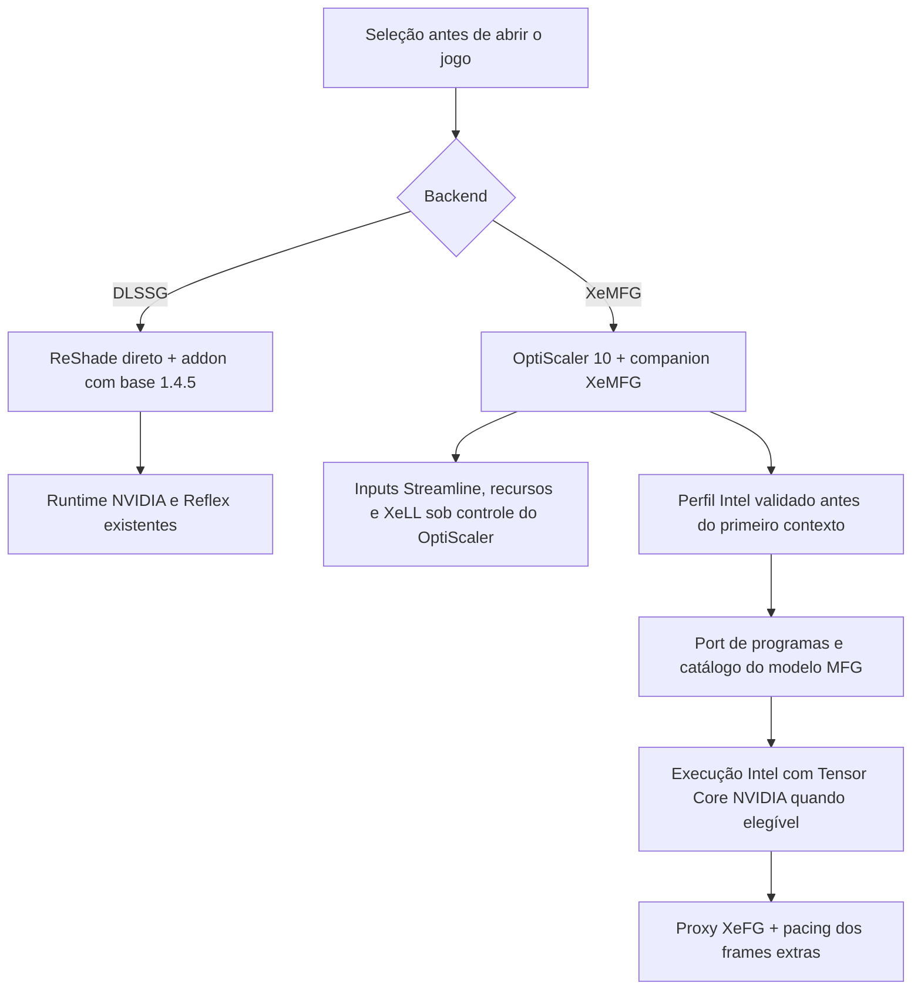

# DLSS-G + XeMFG — primeira integração X1

## Base e resultado

Estado atual: **X1.3 com validação funcional inicial no Cyberpunk**: abertura/cena sem crash relatadas pelo usuário, modelo MFG ativo, sucesso de interpolação 4x/6x no SDK, rota Tensor em uso e metering aceito pelo driver. O usuário avaliou cerca, asfalto e resposta com XeLL como perfeitos. Isso não é benchmark nem certificação geral; erros de entrada também aparecem nas amostras. A X1 falhou no loader, a X1.1 durante Present/XeLL e a X1.2 carregou sem ativar o modelo MFG. A seção final separa as evidências atuais dos resultados históricos.

Branch `feature/1.4.5-xemfg`, criada diretamente da **1.4.5 oficial**, commit `0fe65579d287581107babe267ee3e48c9135bf8a`. As árvores antigas, a release publicada e os experimentos de reconstrução foram preservados. Nenhuma alteração de LMR/MR/CA/DR/TGL integra esta candidata.

A build contém dois backends selecionados antes de iniciar o jogo:

- **DLSSG:** geração, qualidade, guard e controle da base 1.4.5; carregador ReShade direto.
- **XeMFG:** inputs DLSS-G/Streamline recebidos pelo OptiScaler 10, modelo MFG Intel adaptado, 2x–6x, XeLL e apresentação pelo proxy XeFG. Nosso addon não instala os writers DLSS-G nem executa seu controlador Reflex nesse modo.

O produto é composto por `renodx-mfgunlock.addon64` e `plugins/MFGAdaUnlock.XeMFG.asi`. O segundo é compilado de código-fonte integrado; **não é o ASI do dashdogy renomeado**. O OptiScaler permanece uma dependência externa. Esta integração não converte inputs Streamline independentemente dele.

O seletor `Switch-MFGBackend.ps1` exige jogo fechado, verifica o pacote, faz backup dos arquivos atingidos e troca também o perfil do carregador. Isso preserva o DLSS-G nativo da 1.4.5 sem colocar outro gerador sobre ele. O OptiScaler e suas configurações permanecem disponíveis para voltar ao XeMFG. A primeira instalação guarda o plugin MFG anterior; ele não deve continuar ativo junto desta candidata. O RenoDX de Cyberpunk e suas configurações de imagem são preservados.

## Implementação e fronteiras

Reutilização de código MIT do [MFG-Unlocker](https://github.com/dashdogy/MFG-Unlocker/tree/a4cf2c4ab632e84c72254932793bb9e64b33d76e/source/native/xess), commit fixado `a4cf2c4ab632e84c72254932793bb9e64b33d76e`: perfis de instruções, port de shaders/modelo, count unlock transacional, pacing, rota Tensor Core e auxiliares necessários. A origem e as adaptações estão em `src/addons/mfgunlock/xemfg/vendor/PROVENANCE.md`; avisos MIT/MinHook/Intel são distribuídos e incorporados ao companion.

Foram escritos o adaptador de ciclo de vida, a admissão do host, seleção exclusiva, API de estado para o painel, build, empacotamento e troca/restauração. Não foram importados renderer/menu do projeto de referência, reparo de motion vectors, matching de HUD, override de scene cut, nem seu backend NVIDIA. HUD/UI fica sob a integração já existente do OptiScaler/XeFG; esta build não acrescenta uma heurística para a crosshair.

Nesta primeira build, o port é admitido em **GPU NVIDIA**, com OptiScaler de versão principal 10 e este conjunto explicitamente revisado:

| Componente | Versão / SHA-256 |
|---|---|
| XeSS-FG | 1.3.1.78 — `ec5e0c65e075570c6ede72618bb666d0be0c2e10b2ea9762c0fe8cb8e375ab27` |
| XeLL instalado | 1.3.0.5 — `61aeeab7fdcfb6d1742f86c14c68c663d759607d01a6132645c857291eaebb86` |
| XeLL alternativo admitido | 1.3.2.10 — `d2030dcd694fda8f2ec7e044b13e6db8f0b56d4ba9113a5efad334e3f3ded8c7` |
| OptiScaler instalado | 10.0.0.1; build `024c4a1b`; `cea0ef7e4940ad04fd1bcddabbabf7cd307fc2449b460e7e539597f344229b91` |
| ASI fornecido pelo usuário, usado somente como fonte de dados | 1.6.0.1010 — `161b9e1245a3736dc462ee83f4ad51e6125d8e7e73ce3eedde89d2eed60c69fa` |

Hashes dos arquivos e witnesses da imagem em memória são conferidos antes dos patches. A preparação do port ocorre antes de encaminhar o primeiro `CreateContext` observado do host. Um contexto estrangeiro observado antes disso impede a publicação. Módulos, callbacks e payloads publicados têm duração de processo; a troca exige reinício. Não há hot unload do companion. Essa política não transforma o mecanismo de inicialização do loader em uma garantia para todos os hosts: inicialização tardia e providers já utilizados por terceiros não são uma configuração admitida.

Uma falha de identidade deixa XeFG no comportamento nativo; não há fallback para um modelo 2x usado em fases incorretas. Se o port estiver aplicado mas o registro do pacing falhar, a inicialização MFG é recusada e FG é desabilitado naquele contexto. A capacidade anunciada/aceita não deve ser confundida com frames exibidos.

O modelo MFG e seu conjunto de 54 programas são publicados em vez de apenas elevar a contagem. A rota Tensor Core usa kernels de referência reconhecidos por programa e executa nas listas do próprio provider; falhas de admissão mantêm o caminho DXIL. O pacing dos frames extras utiliza os hooks perfilados do SDK. O metering NVIDIA é habilitado somente quando as funções e a fila têm ownership demonstrado; recusa do driver mantém o pacing de software. A resolução da função e da fila não prova que metering esteja efetivo no monitor.

## Evidências e limites

Verificações realizadas na RTX 4070 SUPER:

- Compilação dos dois binários e suíte: **40 testes passaram; 3 opcionais foram pulados**, de 43 registrados. Os skips são `provider_identity` sem entradas NVIDIA explícitas e os dois manifests de targets históricos que não são este pacote.
- Probe Intel com DLLs reais, sem contexto/GPU dispatch: 54 identidades de programas e sete replacements validados; três ciclos completos de port/unlock/restore; quatro capacidades inválidas e um site alterado recusados. As seções executáveis voltaram aos bytes iniciais, e o unload normal do provider não falhou.
- Host sintético, DLLs Intel reais e dispositivo D3D12 real: criação de contexto, capacidade de cinco intermediários, XeLL associado, inicialização de swapchain oculto, registro do pacing, alterações de contagem 2x/3x/4x/6x, enable/disable e destruição retornaram sucesso. Catálogo portado, pipelines reconhecidos e rota Tensor Core foram admitidos. **Não houve Present nem geração de imagem neste teste.**
- O mesmo harness confirmou zero hooks quando DLSSG está selecionado e quando o provider em disco tem hash alterado.
- Instalação em diretório sintético: XeMFG → DLSSG → restauração exata do estado inicial; addon de Cyberpunk, upscaler e plugin anterior preservados. Testada com fixture e cópia do loader OptiScaler real.

Os resultados ficam no pacote/manifest e no diretório ignorado `build/xemfg/source/build/`. Eles não demonstram melhoria visual, ganho de FPS, cadência exibida, latência física ou funcionamento de todos os jogos. A validação real da integração Cyberpunk fica pendente até o usuário abrir a cena. O estado `initialized`, número efetivo apresentado e os lançamentos Tensor Core serão conferidos no painel/log da execução real; um checkbox sozinho não é essa evidência.

Os [contratos Intel](https://github.com/intel/xess/blob/de0fb9c1c510661c571164e1418ceca8101dab69/doc/xess_fg_developer_guide_english.md) exigem XeLL e descrevem o proxy de apresentação; o SDK nativo limita não Intel a um frame gerado. O port é uma modificação independente e não suporte oficial Intel a MFG em Ada. Não se promete qualidade de 60 FPS reais a 25–40 FPS reais.

## Reprodução e entrega

`tools/Build-XeMFG.ps1` recebe checkout RenoDX, headers Intel e ASI de dados explícitos. Os três headers NVIDIA gerados devem coincidir com a 1.4.5 oficial. `prepare_xemfg_inputs.py` faz parsing estático do PE, sem carregar código do ASI, confere o SHA completo, o manifesto de 54 programas e os hashes dos sete shaders/fatbin. Todos os blobs ficam em `build/`, ignorado. Os programas derivados da Intel mantêm seus termos; não são publicados como código MIT. O SDK Intel e seus pesos não são incluídos no pacote.

Headers Intel consultados: commit `de0fb9c1c510661c571164e1418ceca8101dab69`; referência OptiScaler consultada: commit `c2e44a8bc911010d7ed3e4fa63843185fbb55d03`. A build usa os blobs pré-compilados conferidos, não alega ter recompilado HLSL/CUDA nem provar equivalência numérica independente dos kernels do autor.

Pacote local: `out/dual-backend-1.4.5-x1/`, com binários, manifest, licenças, seletores e addon oficial 1.4.5 para rollback. Não foi publicada uma release. O primeiro teste recomendado é o ManualSave-317 em 4x, com os mesmos ajustes, verificando também crosshair, asfalto e contagem efetiva no painel do OptiScaler. Antes de promover, comparar dois jogos, enable/disable repetido, resize/alt-tab, 2x/3x/4x/6x e medir desempenho/pacing/VRAM sem profiler.

## X1.1 — correção do crash de abertura

A tentativa real com X1 falhou antes do primeiro contexto. O minidump `Cyberpunk2077.exe.25356.dmp` mostra `InitializeASI` chamado pelo `DllMain` do OptiScaler durante `LdrpInitializeGraphRecurse`. A consulta de versão feita pela descoberta do layout chegou a código de `libxess_fg` antes de sua inicialização completar; `RtlpWaitOnCriticalSection` falhou com `c0000005`. O teste inicial chamava InitializeASI depois de `LoadLibrary` e não cobria essa ordem.

A X1.1 separou captura e ativação. Durante o callback do loader, registra somente o gate público de Create no SDK já mapeado, retém os módulos e agenda o worker sem esperar. Não chama GetVersion, não lê catálogos do modelo e não carrega runtimes adicionais nessa fronteira. O worker realiza a admissão depois da inicialização de DLLs; o primeiro Create real pode completar essa etapa. Uma chamada a Create ainda dentro do loader é recusada.

O executável de regressão importa estaticamente o SDK Intel, que depende do OptiScaler real como dxgi.dll. A X1 encerrou com `0xc0000142`; a X1.1 chegou a main e confirmou os hooks. Outro teste invoca InitializeASI dentro do DllMain de um host sintético e verifica posteriormente o ciclo de vida XeLL/XeFG e as contagens 2x–6x. Foram 42 testes aprovados e três opcionais pulados, de 45 registrados. Esses testes não faziam Present.

Na tentativa real seguinte, a X1.1 **abriu e caiu depois**, com diálogo REDengine, cerca de dez segundos após iniciar. Portanto, a correção da falha de loader não resolveu toda a integração. A falha seguinte e seus limites estão abaixo.

## X1.2 — ownership das APIs e duração dos contextos nativos

### Segunda falha observada

Relatório local `REDEngine/ReportQueue/Cyberpunk2077-20261019-130344-424-9084`, processo 424, exceção às 13:03:45. O minidump registra `c0000005`, operação de execução (`ExceptionInformation[0]=8`) em memória de dados. A pilha, reconstruída com as DLLs instaladas, passa por `libxell+0xcc61`, `libxess_fg+0x20fac4`, o proxy OptiScaler e `Present` do jogo. O dispatch da implementação XeLL tenta executar um ponteiro sem permissão de execução. Isso demonstra um contexto/dispatch inválido, **não determina por si qual operação anterior invalidou o contexto**.

O log da X1.1 mostra `port_rejected: context_predates_port` e dois `context_create` com `mfg_model=false`. Logo, não há evidência de publicação do modelo, patches de shaders, rota CUDA ou pacing adicional nesta execução. A segunda falha não deve ser atribuída a uma inferência do modelo MFG que nem havia sido aplicada.

Foram reexaminados os fontes do OptiScaler **na revisão instalada**, `024c4a1b79a6484a0ce4c56a8961a0fa03583203`, além da referência mais nova já registrada. Em `XeFGInputs::GameSetEnabled`, o host distingue chamadas do próprio output e chamadas do jogo pelo módulo do endereço de retorno. O gateway upstream MIT de MFG-Unlocker preserva entradas já redirecionadas pelo host; nosso adaptador inicial não preservava essa fronteira.

### Correções implementadas

1. **Não empilhar wrappers sobre redirecionamentos pertencentes ao OptiScaler.** O plano de hooks identifica o salto para código do host e mantém a entrada original. Em particular, o SetEnabled do output continua chegando ao host com o caller correto; não passa a parecer uma chamada do jogo. Nenhuma nova interceptação de XeLL ou segunda rotina de sleep foi adicionada.
2. **Preservar chamadas internas do SDK.** Entradas vindas das próprias imagens Intel seguem para a implementação original, sem transformar um ciclo interno em contexto externo, reaplicar registro do pacing ou validar uma contagem interna como solicitação do usuário.
3. **Trocar o bloqueio permanente por acompanhamento de contextos nativos vivos.** Um probe temporário criado e destruído antes do output deixa de impedir MFG por toda a sessão. A publicação global permanece bloqueada enquanto um contexto nativo observado estiver vivo, inclusive um contexto do host criado durante o adiamento. Uma destruição que falha não libera essa restrição. O log registra caller, handle, aposentadoria e motivo de adiamento.
4. **Atualizar o estado observado por GetLastPresentStatus.** Quando SetEnabled pertence ao host e fica sem nosso wrapper, o painel usa o estado reportado pelo SDK para acompanhar enablement. Essa observação não converte contagem solicitada em frames gerados demonstrados.

As fórmulas, programas, modelo, pacer e configurações de imagem não mudaram. O addon central conserva o mesmo SHA-256 da X1.1 (`8eb5b2a5…aad240`). A revisão do companion passa a `1.4.5.3`, identidade local X1.2. A 1.4.5 publicada e as árvores antigas continuam preservadas.

### Regressões reproduzidas e cobertura nova

| Teste | X1.1 | X1.2 / limite |
|---|---|---|
| Host sintético com SetEnabled redirecionado e verificação do caller | Falha: o wrapper muda o caller; SetEnabled retorna -4 | Passa; dois forwards preservam o caller, com SDK/dispositivo reais e ciclo de vida 2x–6x |
| Probe nativo encerrado antes do output, com loader OptiScaler instalado | MFG permanece recusado por `context_predates_port` | Port admitido; swapchain MFG inicializado, resize e 24 Presents com FG desabilitado passam |
| Probe nativo mantido vivo antes do output | Comportamento anterior conservador | Port continua recusado; resize e 24 Presents no caminho nativo passam |
| Loader frio e InitializeASI no DllMain | Já corrigidos pela X1.1 | Permanecem aprovados |
| Patch/restore do conjunto Intel | Já aprovado offline | Continua aprovado |

Suíte final: **45 aprovados, três opcionais pulados, de 48 registrados**, comando `ctest --test-dir build/tests -C Release --output-on-failure`. Skips: identidade NVIDIA sem entradas explícitas e manifests de dois targets históricos que não compõem este pacote. Os novos testes rodam em pastas próprias e não alteram o jogo. Os Presents são de um swapchain oculto e sem geração habilitada; não demonstram pixels interpolados, scanout, FPS ou qualidade.

As duas regressões offline estão confirmadas por contraste com a X1.1. **Não foi reproduzida fora do jogo a mesma exceção DEP do minidump**, e o dump não captura toda a história de criação/destruição XeLL. Portanto, o nexo exato entre o caller incorreto e aquele contexto inválido permanece uma hipótese fundamentada. A eliminação do crash no Cyberpunk e a execução real do MFG precisam ser verificadas na próxima abertura. Não há alegação de estabilidade em jogo nesta entrega.

Evidências locais: `out/xemfg-second-failure/crash-images.txt`, `crash-latency-context.txt` e `crash-latency-native.txt` na árvore principal; `build/redirect-regression-old`, `build/native-probe-regression-old`, `build/tests/xemfg-checks` e `build/host-ownership-regression-results.json` nesta worktree. O pacote incorpora resultados, hashes e logs dos casos correspondentes ao companion final, sem redistribuir minidumps que possam conter dados do processo.

## X1.3 — preparar o modelo antes do primeiro consumidor do jogo

O usuário confirmou que a **X1.2 abriu e carregou o ManualSave-317 sem crash**. O log dessa sessão, porém, contém `native_context_create`, caller `Cyberpunk2077.exe`, seguido de `port_deferred: native_contexts_live` e contextos do host com `mfg_model=false`. O contexto criado primeiro pelo jogo permaneceu vivo durante a criação do output. Não é correto chamar esse teste de validação do XeMFG 4x: a abertura passou, mas o port não foi publicado, a rota Tensor Core não foi instalada e não há prova de geração 4x. `InterpolationCount=5` no INI é uma solicitação, não comprovação de 6x efetivo.

A X1.3 admite o executável principal e o host OptiScaler como consumidores do backend selecionado. Publica os mesmos programas, catálogo e unlock **antes de encaminhar o primeiro Create admitido**, qualquer que seja a ordem jogo/host. Ambos os contextos nascem com a mesma implementação. O contexto inicial do jogo pode permanecer vivo; ele já foi criado com o modelo portado, em vez de ser alterado posteriormente. O modelo e seus dados continuam retidos até o encerramento do processo. Não há troca de modelo nem reconstrução de buffers de um contexto vivo.

Callers externos que não sejam jogo, host ou o próprio SDK continuam separados: antes da publicação, seus contextos usam o SDK nativo e impedem o port enquanto vivos; depois da publicação, a criação externa é recusada. Chamadas internas Intel conservam o encaminhamento. Uma criação reentrante durante a publicação é recusada, evitando que um consumidor nativo apareça entre o preflight e o commit. As verificações do par de runtimes, GPU e ownership dos redirecionamentos permanecem.

A rota opcional CUDA/Tensor Core é preparada na primeira criação do **output do host**, com o dispositivo desse output. Isso evita prender a rota a um dispositivo usado apenas para a consulta inicial do jogo. O caminho DXIL permanece disponível quando a rota não é admitida; o par de módulos/modelo não muda por causa disso. Não houve alteração de shaders, pesos, inputs de cor/depth/MV, HUD/UI, pacer, waits ou configuração de imagem.

Foi acrescentado um teste que conserva o primeiro contexto do executável vivo, consulta a capacidade de cinco intermediários **antes de criar o output**, cria o segundo contexto pelo OptiScaler real e realiza resize e 24 Presents com FG desabilitado. O teste com a X1.2 falha já na primeira capacidade; a X1.3 passa. Um caller em DLL de teste não admitida mantém um contexto nativo vivo e continua impedindo a publicação, também com Present/resize passando. O teste de probe encerrado foi atualizado para exigir a capacidade correta desde a criação admitida. Os testes anteriores de loader, caller dos redirects, contagens 2x–6x e patch/restore continuam passando.

Suíte da X1.3: **46 aprovados e três opcionais pulados, de 49 registrados**, pelo mesmo comando CTest. Não houve novas capturas de gameplay para essa entrega. Os testes de apresentação usam janela oculta, sem tags de conteúdo nem geração habilitada; não demonstram imagem gerada nem desempenho. A ordem de criação foi reproduzida; o funcionamento completo da nova build ainda depende da abertura da cena.

O log passa a distinguir o proprietário do contexto (`game`/`host`), `model_prepared_before_create`, resultado das contagens e `output_status`. O último registra os campos reportados pelo SDK e o contador de lançamentos da rota Tensor, no máximo uma vez por segundo nas primeiras 30 amostras, depois somente em mudanças. `frames_presented` significa frames enviados à apresentação segundo o SDK; não mede scanout. O contador de lançamentos identifica uso da rota, não duração nem conclusão física de cada kernel. Na próxima verificação, exigir `mfg_model=true`, inicialização com pacing e estado de interpolação coerente com a seleção; não usar apenas ausência de crash ou checkbox como sucesso.

Evidências adicionais: snapshot do log real da X1.2 em `out/xemfg-activation-fix/X1.2-game.log` na árvore principal; contraste com a build anterior em `build/game-first-regression-old`; casos finais em `build/tests/xemfg-checks`; resumo em `build/game-first-regression-results.json`. A identidade local é `1.4.5-X1.3`/arquivo `1.4.5.4`. A candidata permanece na branch isolada; a release oficial não foi alterada nem republicada.

## Validação funcional inicial da X1.3 no Cyberpunk

Em 19/10/2026, o usuário confirmou abertura e carregamento do ManualSave-317 sem crash e, após a verificação do log, relatou: **“ficaram perfeitas, a latencia com xell tbm”**, referindo-se à cerca, ao asfalto e à resposta. Esse é o resultado perceptual do usuário nessa cena, sem nova captura de vídeo, comparação cega ou medição física de latência. A build instalada foi mantida como referência funcional; nenhum binário foi modificado ou recompilado para registrar este resultado.

| Identidade / observação | Evidência e alcance |
|---|---|
| Fonte do binário | `306fe1c9d7eb6670837d4a5c0a4fdd050a2866cc`, derivada da 1.4.5 oficial na branch isolada |
| Companion instalado | `1.4.5.4` / `1.4.5-X1.3`; SHA-256 `13365deb4b355c4f85f7ada54b0f8abbf1919a3db02071ff607b2360241a61c0` |
| Ambiente | Cyberpunk 2.31, file version `3.0.5294808`; RTX 4070 SUPER, driver `617.42`; par Intel e OptiScaler com os hashes registrados anteriormente |
| Modelo | `model_prepared_before_create` com caller do jogo; contextos de jogo e host com `mfg_model=true`, criação bem-sucedida e output inicializado com pacing |
| Multiplicadores | Setters de três/cinco intermediários retornaram sucesso; 25 amostras com quatro frames e oito com seis frames reportados, FG habilitado e resultado de interpolação zero |
| Rota Tensor | `cuda_route: active`, compute capability `8.9`, 16 kernels/17 layers; contador observado de lançamentos cresceu de zero até 312.888 |
| Metering | Fila resolvida; sete amostras de configuração com `metered=true`, status e feedback zero; deadlines registraram uso em lotes 4x e 6x |
| Estabilidade nesta passagem | Sem crash relatado; nenhum relatório REDengine mais novo que o da falha anterior foi encontrado. Isso não cobre sessões longas ou outros jogos |

A cobertura do log da sessão vai do tick `54948203` ao `55114796`, **166,593 segundos**. Isso inclui inicialização e transições; não é uma passagem de benchmark. `frames_presented` é a contagem enviada à apresentação segundo o SDK, não observação de scanout. Os 50 registros de estado são amostras limitadas e mudanças: não permitem calcular taxa de falha, FPS, pacing exibido ou ganho percentual. O contador Tensor comprova uso da rota instrumentada, não tempo/ocupação ou conclusão física de cada kernel. A aceitação de metering não comprova menor latência física.

Há também cinco amostras `-12` (inputs incompatíveis com o modo de composição), três `-14` (inputs insuficientes) e duas warning `4` (ordem/IDs de frames). Várias foram seguidas por retorno a 4x/6x com resultado zero; a última amostra é `-12`, sem retorno antes do fim do trecho salvo. Houve desativações e mudanças de multiplicador no log, mas não foi estabelecido que todas as recusas ocorreram apenas em menus/transições. O usuário não relatou um problema residual de imagem/resposta. Esses eventos permanecem registrados como limite da validação, sem inventar uma causa nem acrescentar alterações de HUD/UI.

Evidências preservadas na árvore principal: `out/xemfg-game-validation-2026-10-19/X1.3-game.log`, `X1.3-session.jsonl` e `validation.json`. O JSON liga relato, amostras e hashes dos módulos ao binário exato; seu SHA-256 é `336fb0add720a7ed6fa4c61bab1976bc83be43a928086414827b09506d5b6758`. O pacote X1.3 original conserva seu manifesto de build e as verificações anteriores à abertura; esta seção e o suplemento de validação são posteriores, sem reescrever a proveniência do pacote nem publicar outra release.
