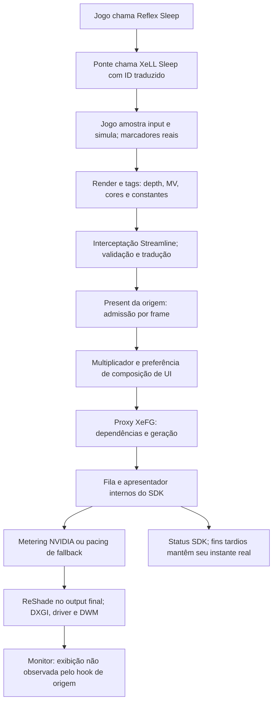

# Auditoria de engenharia — XeMFG R1.6

19/10/2026. **Release x64 compilada; 62 testes passaram, três opcionais foram ignorados.** Foram corrigidos contratos de integração e custos evitáveis de CPU. Não foi demonstrada eliminação dos microstutters, ganho de FPS, melhora de cadência exibida ou redução de latência física. Essas comparações em jogo estão **NOT TESTED** e têm procedimento em [BENCHMARK_PLAN.md](BENCHMARK_PLAN.md).

A base é a R1.5 preservada, commit `94928e414e4f5e8bd453ad70791e7f88dea9d359`, addon SHA-256 `cd902f48500b8ee110c2cd7095a981694ebfbb371db3e5e7ad1aa78237d18647`. Trabalho isolado em `feature/1.4.5-xemfg-pacing-r1.6`, dentro de `build/xemfg-reshade/source`. A árvore histórica modificada e a release pública 1.4.5 não foram substituídas. Inventário inicial de 138 arquivos em `out/xemfg-r1.6-audit/baseline.json`, relativo à raiz histórica; identidades finais no manifesto do pacote. Dados ignorados não estarão disponíveis em clone limpo; o pacote incorpora evidências essenciais.

## Arquitetura e propriedade

O instante de input pertence ao motor. Substituir `slReflexSleep` coloca XeLL na fronteira oferecida pelo jogo; a ponte não comprova universalmente que ela precede a amostragem física do mouse. O runtime possui geração, cópias internas e recursos em voo. Driver, Windows e monitor completam a apresentação. O diagrama mostra dependências observáveis, não uma decomposição dos modelos privados.

| Etapa | Código / proprietário | Sincronização, lifetime e fallback |
|---|---|---|
| Inicialização e perfil | `backend.cpp:391 Start`, `:467 CompleteStartup`; `runtime_payload`, `runtime_layout`, `host_unlock`, `port/model_port`, `port/shader_port` | Hashes/perfis restritos; payload e hooks retidos pelo processo. Rejeição não anuncia modelo pronto. Descoberta/publicação antecede a nova thread de log |
| Contextos e output | `native_bridge.cpp:68 CreateOutput`, `:182 Attach` | Device nativo; fila/factory preservam wrapping ReShade. Um output selecionado; RGBA8/BGRA8/HDR10. Falha devolve erro ao caminho de criação original |
| Inputs e ID | `native_streamline.cpp`, `native_internal.hpp`, `frame_store.hpp` | Token traduzido, viewport selecionado, tags/constantes por frame. Capacidade 16; não expulsar frame futuro/em voo. Inputs incompletos não recebem FG |
| XeLL | `native_latency.cpp:7 SleepSourceFrame`, `:39 ForwardSourceMarker` | Owner compartilhado mantém contexto; epoch invalida conclusão velha. Bookkeeping não cobre `xellSleep` bloqueante. ENDs reais de frames anteriores podem chegar durante o sleep seguinte |
| Admissão/recursos | `native_streamline.cpp:238 BeforePresent`, `native_ui.cpp` | Confere recursos, extents, constantes e fases; tags voláteis usam command list do produtor. Sem estender lifecycle por heurística. UI opt-in, default desligado |
| Geração/Tensor | `vendor/cuda/cuda_route.cpp`, perfis/programas gerados | Layers/bindings admitidos substituem dispatch na command list; não cria fila compute independente. Dispatch não reconhecido conserva shader fallback |
| Present/estado | `native_swapchain.cpp:51 Present`, `:84 Present1`; `native_streamline.cpp:297 AfterPresent`; `backend.cpp:350 LastStatus` | Mutex de Present já existente; fila privada do SDK. Retorno da consulta e resultado de interpolação são campos distintos |
| Pacing | `vendor/sdk_pacing.cpp:416 FlipBeforePresent`, `sdk_pacing_dlssg.h` | Perfil privado, epoch/owner e deadlines existentes. Nenhuma nova fórmula/espera/prioridade; [PACING_ANALYSIS.md](PACING_ANALYSIS.md) |
| Janela/teardown | `native_window.cpp`; `native_swapchain.cpp:10 Resized`, `:23 ~Swapchain`; `Output::~Output` | Janela opt-in na thread proprietária. Resize limpa frames/epoch. Proxy liberado antes de FG, FG antes de XeLL. R1.6 aposenta viewport/IDs do owner correto |

Foram examinados entrypoints, tradução, controladores, callbacks, locks, lifecycle, bindings CUDA, seleção/proveniência de programas, pacing, ferramentas e testes relevantes. Não é auditoria dos pesos ou de toda a implementação privada Intel/NVIDIA. Sem novos readbacks, timestamps GPU, passes de imagem, buffers GPU, hooks de apresentação ou alterações de MV/depth/shaders.

## Versões e referências

| Entrada | Versão / identificação | Situação |
|---|---|---|
| `libxess_fg.dll` | 1.3.1.78; `ec5e0c65e075570c6ede72618bb666d0be0c2e10b2ea9762c0fe8cb8e375ab27` | Instalada; idêntica ao binário da referência SDK; testes 2x/3x/4x/6x |
| XeLL instalada | 1.3.0.5; `61aeeab7fdcfb6d1742f86c14c68c663d759607d01a6132645c857291eaebb86` | Base dos quatro testes; não substituída |
| XeLL alternativa admitida | 1.3.2.10; `d2030dcd694fda8f2ec7e044b13e6db8f0b56d4ba9113a5efad334e3f3ded8c7` | Teste isolado 4x passou; não é benchmark/validação de todas as multiplicações nessa DLL |
| Headers/docs/sample Intel | `de0fb9c1c510661c571164e1418ceca8101dab69` | Referência local; documentação pública aplicável consultada em 19/10/2026 |
| SDK público consultado | XeSS SDK 3.0.2 | Distribuição mais recente consultada; não é versão de cada DLL |
| ReShade direto | 6.8.0.2155; `0cee63f9c9f13f3ac909c5b4903f4dbb4b719a7ab3b4f13b0deaf83c814b94f7` | Testado no transporte nativo |
| Componentes MIT dashdogy | `a4cf2c4ab632e84c72254932793bb9e64b33d76e` | Núcleo de pacing já reaproveitado; não novidade R1.6 |
| OptiScaler | `c2e44a8bc911010d7ed3e4fa63843185fbb55d03` | Referência/teste do companion; implementação GPL não copiada; addon nativo não depende dele |

SDK 3.0.2 atualiza XeLL para 1.3.2.10, corrige unidades de `xellGetSleepMode`, leak condicionado a markers sem Presents e compatibilidade com proxies Streamline; recomenda objetos D3D12 nativos. SDK 3.0.1 corrige tight alignment e limiter após resize/mudança de quantidade. O XeFG instalado coincide com a referência atual: não atribuir essas correções como ausentes pelo número da distribuição. Não se reproduziu o leak neste mod. [Release 3.0.2](https://github.com/intel/xess/releases/tag/v3.0.2), [release 3.0.1](https://github.com/intel/xess/releases/tag/v3.0.1).

O contrato Intel admite só um frame gerado em GPUs não Intel. O mod usa adaptações experimentais de modelo, Tensor e apresentação para 3x–6x NVIDIA; teste funcional não equivale a suporte oficial. Driver pacing Intel e NVAPI NVIDIA são distintos. [Suporte e proxy XeFG](https://github.com/intel/xess/blob/de0fb9c1c510661c571164e1418ceca8101dab69/doc/xess_fg_developer_guide_english.md#proxy-swap-chain).

## Recomendações oficiais versus implementação

| Recomendação | Estado | Evidência / limite |
|---|---|---|
| Sleep antes de input; mesmo ID nas fases | Parcial | Rota Reflex→XeLL/ID preservada; posicionamento depende do motor |
| Evitar sleep/controladores duplicados | Implementada na rota admitida | Dedup, desliga sleep Reflex nativo e traduz limiter. Caps externos continuam exigindo controle |
| Marcadores reais, pares START/END | Reforçada | END sem START rejeitado; overlap/END tardio permitidos; não fabrica markers ausentes |
| XeLL associado ao FG e destruído depois dele | Implementada no fluxo examinado | `SetLatencyReduction`, owner compartilhado; falha arbitrária/device loss não integralmente provados |
| Device nativo | Corrigida para os contextos | Ambos recebem `o->device.Get()`; não troca queue/factory indiscriminadamente |
| SleepMode com GPU ociosa | **Aberta, P0** | `CreateOutput:101` / `SleepSourceFrame:18` não provam quiescência de toda atividade GPU; init da ponte não prova idle de outras filas |
| XeLL cross-vendor com FG suportado/ativo | Parcial | Rejeita criação incompatível; chamadas continuam durante off/on. Efetividade depende de interpolação ativa |
| VSync/sync interval coerentes | Dependente do jogo | Preserva sync/flags; não força VSync/VRR globalmente |
| Inputs válidos até consumo | Traduzida; prova em jogo parcial | Voláteis/legacy testados e bypass; metadata não comprova pixels ou validade universal do motor |
| Create/init/destroy com exclusão adequada | Parcial | Fluxo de um output testado; `Active()` não é transação para duas criações simultâneas |
| Proxy/pacer do SDK | Preservada com extensão já existente | Sem segundo pacer. Waitable do sample não copiado sem ownership exclusivo |
| Debug sem confundir com display | Reforçada | Ring CPU, query status separada; PresentMon não aplica heurística NVIDIA ao XeFG |

Comparação com [guia XeLL](https://github.com/intel/xess/blob/de0fb9c1c510661c571164e1418ceca8101dab69/doc/xell_developer_guide_english.md), [header](https://github.com/intel/xess/blob/de0fb9c1c510661c571164e1418ceca8101dab69/inc/xell/xell.h) e [sample FG](https://github.com/intel/xess/blob/de0fb9c1c510661c571164e1418ceca8101dab69/samples/basic_sample_frame_generation/basic_sample.cpp). O sample possui ownership que uma ponte genérica não deve presumir.

## Achados implementados

| ID | Diagnóstico / localização | Mudança e validação | Benefício condicionado |
|---|---|---|---|
| C01 | `CreateOutput` obtinha device nativo mas passava proxy aos CreateContext | `native_bridge.cpp:97/103` passa device unwrapped; SDK real/ReShade nos quatro multiplicadores | Compatibilidade; nenhum crash antigo atribuído a esse ponto |
| C02 | `ForwardSourceMarker` aceitava END sem START | Guard por frame; testes de ausência, dedup, overlap, END tardio e sleep concorrente | Evita par inválido conhecido; não repara o motor |
| C03 | Destruição deixava viewport/IDs globais selecionados | Limpa somente owner atual; smoke libera chain e aceita opção de outro viewport | Evita seleção herdada; não é suporte completo multi-output |
| P01 | `WriteLog` abria/escrevia/fechava arquivo no callback | `async_log.hpp`, `backend.cpp:46/512`: fila fixa/try-lock/drop, worker em batches; sink bloqueado não bloqueou produtores | Retira I/O síncrono da origem; causa de microstutter ainda hipótese |
| P02 | `FindFrame` alocava nós map por admissão | `frame_store.hpp`: fixo 16; lotação, prune, limpeza, IDs e late frames testados | Remove heap do container, não todas as alocações do processo |
| D01 | Faltava decomposição CPU bounded por ID/epoch | `native_diagnostics.*`, Present/Present1 e sleep por frame; testes focados + SDK real | Diagnóstico default off; sem display/GPU/latência física inferidos |
| D02 | Heurística NVIDIA de AnimationTime era aplicável a XeFG | Scripts PresentMon: domínio XeMFG, manifesto nativo, p99.9 e threshold comum opcional; fixtures passaram | Evita comparações semânticas falsas; não muda runtime |

Microbenchmark com `Frame` completo de 192 bytes, 100.000 frames, dez consultas por frame, três execuções alternadas: map **7,8514 / 7,6700 / 7,6543 ms**; fixo **5,0752 / 5,2346 / 5,1802 ms**, por execução completa. São 100.000 inserções de nós versus zero nós heap no container fixo. Não mede contenção real, todas as alocações ou FPS do jogo; não extrapolar esses milissegundos para um frame. Evidência `frame-store-benchmark-final.json` no pacote.

## Priorização

Confiança no diagnóstico não implica confiança em ganho perceptual. P0 aberto não significa que causou os sintomas.

| Prioridade | Melhoria | Benefício esperado | Risco | Status |
|---|---|---|---|---|
| P0 | C01 device nativo | Compatibilidade de contextos | Baixo–médio | Implementada; SDK real passou |
| P0 | C02 pares XeLL / C03 aposentadoria | Contratos e sessão coerentes | Baixo–médio | Implementadas; testes focados passaram |
| P0 | GPU idle para SleepMode | Completar contrato de configuração | Alto se esperar errado | **Aberta**, requer ownership/timeline |
| P1 | P01 log fora dos produtores | Evitar stalls de arquivo no callback | Médio: perdas/tail | Implementada; efeito em jogo **NOT TESTED** |
| P1 | D01/D02 medição por domínio | Localizar causa real do stutter | Baixo, default off | Implementadas; A/B pendente |
| P1 | Lifecycle concorrente/resize | Evitar race/deadlock nas transições | Alto | **Aberta**, fluxo sequencial testado |
| P2 | P02 storage fixo | Menos alocação/CPU | Baixo–médio | Implementada; microbenchmark favorável |
| P2 | A/B XeLL 1.3.2.10 | Avaliar correções em sessão longa | Médio | Smoke 4x passou; jogo **NOT TESTED** |
| P2 | GPU/JIT/residência/filas | Encontrar custo fora da CPU | Baixo para observar | **NOT TESTED**, protocolo definido |
| P3 | Detector de scene change/outro scheduler | Possível efeito em giro rápido | Alto: ghosting/latência | Não alterados; precisam ablação |

`Active()` seguido de publicação não serializa duas criações. A API documenta exceções de thread safety para create/init/destroy. Não foi reproduzida corrida em jogo. Resize/Present não receberam uma trava global nova: bloquear a thread da janela pode deadlockar Present que espera message pump. É preciso contrato do host e teste reentrante antes de mudar essa fronteira. [Multithreading XeFG](https://github.com/intel/xess/blob/de0fb9c1c510661c571164e1418ceca8101dab69/doc/xess_fg_developer_guide_english.md#multithreading), [DXGI Present](https://learn.microsoft.com/en-us/windows/win32/api/dxgi/nf-dxgi-idxgiswapchain-present).

Pendências adicionais: device loss, multiadapter, enumeração de módulo descarregado durante descoberta, solicitação de janela cujo HWND morreu, lifetime process-long dos hooks, residência/cache em sessão de horas. Não se inferiu leak/crash nesses casos. Não há hot unload seguro. Liberar memória privada por timer ou copiar waits de outro SDK não os resolve.

## Validação e limitações

- MSVC/VS2022 Release x64 passou: `cmake --build build/tests --config Release -j 2`.
- `ctest --test-dir build/tests -C Release --output-on-failure`: **62 passaram / três skipped / zero falhas**, 49,55 s. Skips `provider_identity`, `engineering_manifest`, `release_1_4_5_manifest` dependem de entradas históricas opcionais; não contados como aprovação.
- SDK real/ReShade: 2x/3x/4x/6x, modelo/Tensor, tags modernas/legacy/voláteis, bypass, UI opt-in/off/HUD-less ausente, disable, resize, destruição e aposentadoria de viewport. Mais um 4x XeLL 1.3.2.10. Janelas sintéticas/ocluídas não validam cadência/qualidade em jogo. O smoke provoca falhas de inputs/desativação; esses status não são ocultados pelo relatório.
- Testes focados de storage, markers/lifetime, log, ring e PresentMon passaram; patch/restore existente passou. Sem shader alterado; inferência real foi exercitada, não só compilação de fragmentos.
- Widgets reais renderizados com status sintético: quatro abas, General compacta 460/fonte22, routing expandido 600/fonte20, tooltip, popup e diagnóstico expandido. Inspeção visual/guards de overflow. O harness de tabs não seleciona o combo compacto na tentativa routing 460/fonte22; essa tentativa não foi declarada aprovada.

Falhas intermediárias constam nas evidências: teste do logger pôs dois containers ~2 MB na stack, corrigido para heap como produção; fixture PresentMon apontou `.summary.csv`, corrigida; thread do logger antes da descoberta produziu `module_path` nos testes do companion. Worker agora inicia depois da descoberta e os três testes passaram, inclusive na suíte final. A ordenação não prova resolver toda corrida de loader.

Logger: ~2 MB de fila mais batch, prioridade normal, sem disco no produtor. Ring: 2.048 amostras CPU. Não é VRAM. Contenção, lotação ou oversize geram drops contados; falhas de sink são contadas por batch. Campos ainda podem alocar; kill/crash perde tail; não se garante recuperação de qualquer erro de disco. Diagnóstico adiciona trabalho e não embasa ganho de FPS.

## Revisão crítica

A causa dos microstutters permanece aberta: fonte, GPU, caps, driver/compositor e deadline precisam correlação. Retirar I/O remove risco concreto mas transfere trabalho e não prova gargalo. P02 economiza pouco em termos absolutos no sintético. Nada autoriza retirar fences/aumentar buffering. Mudança de PresentMode pode alterar resultado sem mudar pacer. Aprovação subjetiva anterior não valida automaticamente este binário. Só A/B de exibição/latência, DLLs e fonte fixadas, autoriza promover alegações de ganho. Detalhes por mudança em [CHANGELOG.md](CHANGELOG.md).
