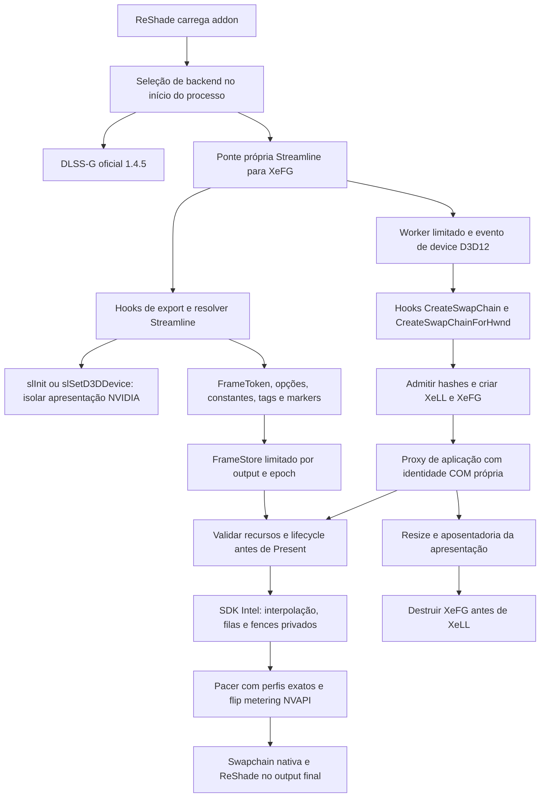

# XeMFG — compatibilidade e estabilidade R1.10

20 de outubro de 2026. Base `622b375`, candidata em `feature/1.4.5-xemfg-stability-r1.10`, na worktree `build/xemfg-reshade/source`. A árvore antiga e os pacotes selados anteriores são preservados. Este documento acompanha investigação e implementação; cada validação em jogo é atribuída ao PID/build correspondente.

## Arquitetura antes das alterações



| Área | Implementação e fronteira |
|---|---|
| Inicialização | `addon.cpp`, `native_bridge.cpp`: backend fixo ao carregar; worker de até 80 passagens. Não há descoberta contínua em cada Present. |
| Streamline | `native_streamline.cpp`: hooks de ciclo de vida, resolver, options/state, tags/constants, sleep, markers PCL e helpers de Evaluate. Isolamento NVIDIA usa API pública em fronteira de startup. |
| Factory | `native_bridge.cpp`: slots 10 e 15. A R1.9.5 adicionou a API antiga usada pelo Control; formatos não suportados seguem para a chamada nativa. |
| Inputs | `FrameStore` com 16 entradas. `ONLY_NOW` é copiado pelo SDK no comando do produtor. Unwrapping limitado; dispositivo, formato, subrect e estado são validados. AddRef não estende validade do conteúdo. |
| Constantes | Conversão de matriz de câmera, escala de MV pela extensão real e validação de flags finitas. Inverted depth e jitter são flags de inicialização do SDK. Não se pode aceitar uma mudança sem reconfigurar corretamente a feature. |
| Latência | `native_latency.cpp`: Reflex → XeLL ou Reflex → Reflex, com XeLL auxiliar de markers. Nenhuma trava de bookkeeping atravessa o sleep externo; timestamps de marcadores não são fabricados. |
| Present | `native_swapchain.cpp`: serializa chamada da aplicação; valida inputs, define Present ID e opções Intel, chama proxy Intel e consulta status. Present de teste é encaminhado. |
| ReShade final | `native_overlay.cpp`: runtime manual ligado à swapchain nativa e à fila de apresentação Intel, após interpolação; estado de input pertence ao ReShade. |
| Modelo/pacer | `backend.cpp`, `host_unlock.cpp`, `cuda_route.cpp`, `sdk_pacing.cpp`: módulos e instruções admitidos por perfil; port CUDA/Tensor, clock e NVAPI. As dependências de recursos do SDK não são removidas. |
| Teardown | Proxy da aplicação aposenta apresentação antes de soltar leases de operações; contexto XeFG precede XeLL. SDK que recusa destruição conserva dependências. Referências externas da swapchain não podem ser liberadas por adivinhação. |
| Diagnóstico existente | Ring opcional de CPU em Present. Sem atribuição por chamada interna, sem timeline GPU do jogo. Log de hitches limitado pode deixar de registrar pausas posteriores; ausência de evento não prova ausência de stall. |

## Casos separados e primeira falha observável

| Caso | Evidência inicial | O que ainda não se pode concluir |
|---|---|---|
| TLOU2, PID 22732, R1.9.5 | Contexto Intel e recursos 7 aceitos; `markers=0`, `constants=1`, `valid=0`, `failed=1`, nenhum lançamento Tensor. | Não é falha de criação nem prova de falta de depth. Precisamos separar entrada de markers não interceptada, ordem por frame e razão de recusa das constantes. |
| Steam/Pragmata | Comparação anterior controlada: overlay ativo mantém referências nativas e recriação falha com `0x80070005`; desligado permite boot. Lease extra não resolveu e foi descartado. | Pilha com Steam não atribui todas as referências a ele. Não há autorização para soltar referências estrangeiras nem desligar overlay silenciosamente. |
| Requiem, PID 18076 | Inferência 4x ocorre e há hitches; dados atuais são CPU/pacer e têm limite de logs. Configuração salva atual voltou a DLSS-G. | Não atribuir pausas de segundos a XeLL, GPU, SDK ou metering sem segmentar as chamadas e correlacionar progresso da GPU. |
| Onimusha | Logs disponíveis incluem falhas antigas de runtime/caminho e outra composição de loaders. | Não tratar dados de OptiScaler/ASI como teste da ponte nativa atual nem generalizar causa do Requiem. |

## Referências e licença

OptiScaler local: commit `c2e44a8bc911010d7ed3e4fa63843185fbb55d03`, GPLv3. Usado para comparação de responsabilidades e rotas de API, sem incorporação de código. A separação input/output, suporte ao entrypoint histórico de markers, configuração por flags reais e cuidado com lifetime são referências arquiteturais; não são prova de que seus fallbacks se aplicam aos nossos objetos. A implementação nova parte dos contratos públicos Intel/NVIDIA/Microsoft e do código MIT existente.

Fontes: [OptiScaler](https://github.com/optiscaler/OptiScaler), [Intel XeFG](https://github.com/intel/xess/blob/main/doc/xess_fg_developer_guide_english.md), [NVIDIA Reflex](https://github.com/NVIDIA-RTX/Streamline/blob/main/docs/ProgrammingGuideReflex.md). O serviço de controle de interface não respondeu (`native pipe`, OS error 2); testes locais que dependam de carregar uma cena serão identificados separadamente de probes sintéticos e de boot.

## Implementação entregue

### Markers antigos e associação de inputs

O resolver agora admite `slReflexSetMarker`, além de `slPCLSetMarker`. As funções originais são encaminhadas separadamente; dois nomes que apontam para a mesma função compartilham o trampoline, evitando um segundo hook sobre o primeiro. Os markers repetidos preservam o contrato de encaminhamento e usam a deduplicação existente da ponte XeLL. Não foram fabricados timestamps nem inseridos markers de simulação em Present.

Uma fixture que só expõe o nome antigo reproduziu a recusa da R1.9.5 selada. Na candidata, o mesmo teste executa inferência real em XeLL e Reflex. Há ainda casos com os dois nomes distintos e com nomes aliases. O probe com as DLLs reais do TLOU2 precisou usar `slSetTag`: seu interposer não exporta `slSetTagForFrame`. A ponte já interceptava a API antiga; a suposição incorreta estava no emissor de teste.

O conversor de constantes foi extraído para `native_constants.hpp`, com motivos independentes de recusa: ABI, câmera, movimento 3D, convenções de depth/jitter, reset e valores não finitos. A recusa informa `native_constants_status` e uma mensagem específica no painel. O log tem orçamento de 12 mudanças por saída. Convenções incompatíveis não são aceitas por heurística; a rejeição de jitter indefinido passou a ser explícita.

### Identidade COM e criação concorrente

Antes de inicializar o SDK, a ponte identifica a fila nativa pelos contratos públicos COM já admitidos no projeto. O SDK retém essa identidade; não prolonga a vida de um wrapper de outra camada. Um teste com wrapper de fila verifica contagem de referências, inferência e teardown.

A factory só é substituída por sua identidade nativa quando seu entrypoint continua coberto pelo hook do output final. Caso contrário, preserva-se a factory recebida. Isso evita perder o runtime final do ReShade ao atravessar uma implementação de factory diferente. Não há varredura de ponteiros nem uso de layouts privados de overlays.

Uma trava de ciclo de vida serializa seleção de saída, criação, inicialização e destruição de contextos. Ela é adquirida antes de consultar a saída ativa, fechando a corrida entre duas threads de factory. O teste inicia duas criações simultâneas: uma recebe o único contexto Intel selecionado; a outra segue pelo caminho nativo. Ambas são liberadas sem contexto remanescente. A trava não foi colocada no caminho normal de cada frame.

Essa mudança segue a exclusão explícita de criação/inicialização/destruição do contrato thread-safe do [SDK Intel](https://github.com/intel/xess/blob/main/doc/xess_fg_developer_guide_english.md#multithreading). Corrige uma lacuna de implementação; não estabelece que essa corrida tenha causado as pausas relatadas.

### Diagnóstico opt-in de pausas

`native_trace` registra CPU por chamada e observa chamadas ainda pendentes. Desligado por padrão, o caminho de trace consulta uma flag atômica e retorna. O worker é iniciado fora do loader, fica associado ao addon já fixado no processo e só observa quando habilitado. Não cancela chamadas nem muda a política de waits.

O registro cobre espera da trava de Present, preparação, Present Intel, pós-Present, Reflex sleep, XeLL sleep, tagging, inicialização/destruição, atualização final do ReShade, Present nativo, chamada de flip metering, pacing extra e lançamentos CUDA. Chamadas concluídas acima de 100 ms e falhas são registradas; chamadas pendentes acima de 500 ms recebem amostras com ticket/thread/frame. O observador de longa duração permite registrar uma pausa posterior ao orçamento antigo de hitches. `GetLastError` é preservado.

Com `GpuTiming=1`, uma arena limitada adiciona timestamps e sinais em uma fence própria na fila de origem. Slots são reutilizados somente após conclusão, sem wait da CPU ou da GPU introduzido pelo diagnóstico. Um teardown com trabalho ainda em voo conserva a arena e desabilita novos diagnósticos GPU; não libera allocators/readback em uso nem bloqueia o jogo para coletar um número. Essa retenção excepcional é um limite do diagnóstico e fica registrada.

O span de fila de origem não é duração de um kernel privado XeFG. Uma fence concluída não prova GPU globalmente ociosa; uma fence pendente não prova deadlock. `tools/analyze_xemfg_runtime.py` exige PID explícito em logs concatenados e conserva essa distinção. Warnings positivos do SDK ficam separados de erros negativos.

## Resultado por problema

| Problema | Causa demonstrada / primeira fronteira | Mudança e estado |
|---|---|---|
| TLOU2 sem interpolação | A captura real R1.9.5 recebeu recursos, mas ficou sem markers associados e recusou constantes. O nome antigo é uma lacuna reproduzida separadamente. | Hook legado corrigido e validado em teste com SDK real. Motivos de constantes agora observáveis. **Gameplay continua não verificado**; não há leitura das constantes reais da cena nesta candidata. |
| Steam Overlay / Capcom | Boot anterior correlaciona overlay ativo, referências nativas remanescentes e falha de recriação do HWND. O teste novo reproduz a restrição com referências mantidas por um observador nosso. | Identidade de transporte reforçada; nenhum `Release` de referência estrangeira. **Conflito com Steam ativo não confirmado corrigido.** Não se alteraram configurações do Steam nesta investigação. |
| Requiem / pausas de segundos | Inferência 4x anterior funciona. Logs antigos mostram hitches de até cerca de 226 ms no orçamento inicial; não localizam os stalls de segundos. INI atual está em DLSS-G. | Corrigida a concorrência de ciclo de vida; instrumentação nova separa chamadas e progresso da fila. **Causa dos stalls ainda não atribuída**, sem alegação de ganho de pacing. |
| Onimusha / pausas | Instalação atual usa `dxgi.dll` do OptiScaler 10.0.0.1, ReShade separado e XeFG no OptiScaler. Logs disponíveis da ponte incluem recusas antigas de runtime/caminho. | Instalação preservada. **Não há reprodução controlada do stall na ponte nativa.** Trocar só o addon não converte essa arquitetura; precisa de rodada separada antes de atribuir causa. |

O teste de referências externas não usa Steam nem reproduz seus hooks. O observador mantém duas referências próprias na swapchain nativa; a recriação falha enquanto elas existem e volta a funcionar após o próprio observador liberá-las. O contexto Intel já está destruído nesse ponto. Isso demonstra o limite de ownership e protege contra uma futura tentativa de corrigir o problema soltando referências desconhecidas. A [restrição DXGI de uma swapchain flip por HWND](https://learn.microsoft.com/en-us/windows/win32/api/dxgi1_2/nf-dxgi1_2-idxgifactory2-createswapchainforhwnd) é compatível com essa observação, sem identificar o dono de cada referência do caso real.

## Testes e limites de evidência

Build Release com MSVC/VS 2022. A suíte completa terminou com **109 aprovados, 3 opcionais ignorados e nenhuma falha**, em 243,45 s, fora da sandbox. Os skips são `provider_identity`, `engineering_manifest` e `release_1_4_5_manifest`; não são validação nova desses artefatos históricos. O XML CTest e o manifesto preservam os recibos. Os novos contratos cobrem constantes, parser, watchdog, markers legados/distintos/aliases, fila com wrapper, criações concorrentes e referências nativas externas. O teste de watchdog usa uma espera artificial; não simula uma GPU travada.

A primeira execução restrita da suíte ficou presa no encerramento NGX; foi interrompida para isolar a variável. O controle R1.9.5 selado também teve timeout no mesmo estágio dentro da sandbox e concluiu fora dela, usando os plugins do Pragmata. O dump restrito contém endereços de `_nvngx`, NVAPI e telemetria NVIDIA na pilha bruta, sem unwind que autorize uma atribuição mais específica. A evidência sustenta dependência do ambiente de teste; não sustenta retirar chamadas de shutdown nem modificar a telemetria do sistema. A suíte completa foi repetida fora da sandbox e passou.

Probes extras, fora da suíte de regressão, têm resultado incompleto e são preservados como tal:

| Probe | Resultado observado | Limite |
|---|---|---|
| R1.9.5 selada + fixture com markers somente antigos | Recusa antes de publicar saída pronta. | Controle negativo da lacuna de API, não execução do jogo. |
| DLLs genuínas do TLOU2 + candidata, XeLL | Quatro ciclos de inferência e recriação; 1.248 Tensor launches; contextos Intel retirados. Timeout no shutdown, último log em NGX. | **Teste completo falhou**, não conta como gameplay ou teardown aprovado. |
| DLLs genuínas do TLOU2 + candidata, Reflex | Na sandbox: quatro ciclos e timeout NGX. Fora dela: quatro ciclos, 1.248 Tensor launches, shutdown retornou zero e depois houve access violation no encerramento do processo. | **Teste completo falhou**; não ocultar o exit code porque o emissor escreveu PASS antes dos destructors. |
| DLLs genuínas do TLOU2 + R1.9.5, PCL, fora da sandbox | Quatro ciclos, inferência e shutdown zero, seguidos de access violation no encerramento, como na candidata. | Reproduz um limite anterior nesse harness/plugin; não prova que o jogo real sofra a mesma falha nem que a candidata tenha resolvido seu teardown. |
| DLLs genuínas do TLOU2 sem nosso addon | Sandbox: access violation depois de dois ciclos. Fora: Present `0x80004004` depois de dois ciclos. | Controle também incompleto, com apresentação NVIDIA não isolada; não é comparável ao timeout NGX como causa única. |
| Boots automáticos TLOU2 com emissão intermediária | Hooks de markers instalados; sem chegar à cena nem à criação de saída dentro do trecho observado. Controle R1.9.5 também não chegou à saída. | Não é teste da emissão final nem permite atribuir regressão de boot. Processos encerrados pelo harness; addon e INIs originais restaurados e hashes conferidos. |

A primeira rotina de boot precisou concluir a restauração após aguardar a liberação assíncrona da DLL; o addon original foi restaurado e conferido. Os probes posteriores aguardam a saída do processo e repetem a restauração quando o arquivo ainda está ocupado. O hash restaurado é `bce5e0cef035e546ef02783a7efa282d3eee71615f08f94d6430924ae5f38ba3`.

O dump de exceção do probe TLOU2 fora da sandbox identifica `sl.dlss_g.dll+0x1c4d7` como endereço de exceção após shutdown zero. A execução R1.9.5 apresenta a mesma fronteira; não foi alterado o plugin NVIDIA para mascará-la. Os resultados JSON preservam `exit`, `timed_out`, inferência e shutdown como campos independentes.

Não foram medidas melhorias de FPS, exibição, latência física ou estabilidade em uma nova sessão de gameplay. O Control foi confirmado em gameplay **na R1.9.5**, e o Pragmata **na R1.9.4 com overlay desligado**; esses resultados não são promovidos automaticamente a validação desta candidata.

## Uso da candidata e próximos dados necessários

A entrega R1.10 é um addon local com símbolos, manifesto, recibos e rollback para R1.9.5/1.4.5. SHA-256 do addon: `5f52486f77943f6a5e2c05224c3ae673fad318c869934476f92c3f0f4a558561`. Não publica release e não modifica DLLs Intel, driver, configuração de overlays ou a instalação OptiScaler do Onimusha. Requer uma instalação nativa de ReShade já funcional e o par Intel admitido: XeFG 1.3.1.78 com XeLL 1.3.0.5 ou 1.3.2.10 pelos hashes existentes. FP16/scRGB, Vulkan/D3D11, CoreWindow/composition e seleção simultânea de múltiplas features continuam fora da ponte implementada; formatos recusados usam o fallback nativo existente. A cobertura numérica CUDA disponível continua sendo nove dos 17 programas de camada, conforme a proveniência anterior; esta entrega não amplia essa evidência para os oito originais ausentes.

Para uma captura de stalls, com o jogo fechado, adicionar ou editar na seção existente do `MFGAdaUnlock.ini`:

```ini
[Diagnostics]
StallTrace=1
GpuTiming=1
```

Desligar ambos após o diagnóstico. Essa captura deve ocorrer em XeMFG confirmado pelo log; Requiem salvo em DLSS-G não mede a ponte Intel. Repetir até atravessar uma pausa e preservar o PID que executa a cena. O relatório é produzido por:

```powershell
python tools/analyze_xemfg_runtime.py "caminho/MFGAdaUnlock-XeMFG.log" --pid 1234 --output runtime-summary.json
```

Um `xell_sleep` pendente localiza a espera na API XeLL, mas ainda requer correlacionar o consumidor/fence; `xefg_present` acompanhado de uma fila de origem atrasada aponta outra fronteira; `native_present` ou `reshade_final_update` separam apresentação final e overlay. A instrumentação não autoriza retirar waits do SDK. Capturas de desempenho devem manter o diagnóstico desligado e comparar pares equivalentes.

Para TLOU2, a próxima sessão real deve revelar `native_constants_status`, markers, recursos aceitos e status de saída no mesmo PID. Para Steam/Pragmata, é necessária uma rodada com overlay ativo **sem alterar sua configuração silenciosamente**, acompanhando a criação e aposentadoria reais. Para Onimusha, primeiro separar o transporte OptiScaler do transporte nativo numa instalação com backup e opção explícita; nenhum resultado de um deve ser atribuído ao outro.
